# Architecture

This document describes the internal structure, dependency rules, and runtime data flows of `iam-org-membership`.

`iam-org-membership` is a **private Go service** (`github.com/BCBP-SOLUTIONS-FZC-LLC/iam-org-membership`, Go 1.26.10) deployed as a containerised microservice (HPA 2–8 replicas), refining **IAM HLD v1.41 §5.6** (LLD v2.28, `docs/lld/iam-lld-org-membership-service.md`; where LLD and HLD disagree, HLD is authoritative). It owns the **organizational layer** of the IAM platform — tenants, department activation, tenant/department memberships, tenant-level role grants, and the invite→accept staging flow — and is the source of truth AuthZ Enrichment reads on **I-8** (`GET /api/v1/internal/users/:id/memberships`), the hottest path in the system, hit on every authenticated request (SLO 15 ms p99 hit / 30 ms p99 miss). It ships as **three binaries from one image**: `cmd/server` (the full HTTP surface — public/internal/operator — plus three inbound SQS consumers, the transactional outbox runner and five metric-exporter goroutines), `cmd/reconciler` (a single binary dispatched by `--job=<name>`, covering 7 CronJobs) and `cmd/migrate` (applies the schema once per release as a Helm pre-install/pre-upgrade hook Job, then exits).

This repo is mid-way through a **service decomposition** (ADR-0007 + ADR-0008): departments/plans catalog ownership moved to Catalog / Admin Config Service, SAML group→dept/role mapping moved to Group Mapping / JIT Config Service, tender ACL overlays moved to Tender ACL Service, and delegation grants + OOO coordination moved to Delegation Service. This repo — "Core" — is what's left after all four extractions; the removal has already landed on this branch (pre-production, no staged expand/contract needed).

**Does not own:** credentials, MFA enforcement, JWT issuance (Keycloak); display identity, signature, OOO presentation flag (User Profile); global department catalog / plan entitlement catalog (Catalog / Admin Config Service); group→dept/role JIT mapping tables (Group Mapping / JIT Config Service); tender ACL overlay `tender_acl_entries` (Tender ACL Service); delegation record/lifecycle/policy/events `delegations` (Delegation Service); realm/Keycloak Admin API mutations (Realm Provisioner — this service **never** calls Keycloak); workflow template authoring or `assignee_overrides` state (Workflow Service); audit records (Audit Log); pricing/currency (Billing).

---

## Layer model

The service is organised in concentric Clean Architecture layers. Inner layers have **zero knowledge** of outer layers; dependencies always point inward.

> Source: [`docs/architecture/mermaid/layer-model.mmd`](docs/architecture/mermaid/layer-model.mmd)

```mermaid
graph TD
    subgraph cmd["Composition Roots  —  cmd/ (three binaries, one image)"]
        main["server/main.go + wiring.go + exporters.go\nwire all dependencies\npgcommon.NewPool with GUCProvider = GUCSetFromContext (RLS-6) + BYPASSRLS sysPool (PoolName=system)\nRUN_MIGRATIONS unset/true → MigrateSchema at startup (Helm sets false — the migrate hook Job owns it)\nrouter registration + gincommon.ObservabilityMiddlewares\n/metrics = gincommon.MetricsHandler() on METRICS_PORT (9090)\n3 SQS consumers via sqspipeline (tenant-orgm-q · billing-orgm-q · catalog-orgm-q)\n5 in-process metric exporters (ticker goroutines, 5 min):\n  iam_org_membership_tenant_ownerless · iam_org_membership_realm_sync_pending\n  iam_org_membership_seat_overage_active · iam_org_membership_pending_invitations_stale\n  iam_rls_violations_total (counter, rls_violation_log scrape)\nRoutingPublisher (2 SNS topics, each with its own GlueCodec) + outbox runner\ngraceful shutdown: SIGTERM → HTTP + SQS drain (parallel, ≤30s) → outbox (30s) → both pools (parallel, fresh 10s)\nterminationGracePeriodSeconds=75"]
        swagger_info["server/swagger_info.go\nSwaggo API metadata annotations"]
        reconciler["reconciler/main.go\nsingle binary, --job=<name> dispatch\nselects one of 7 CronJobs (§13.1):\n  invitation-expiry · invitation-kc-cleanup\n  realm-config-sync · seat-overage-reconcile\n  trial-cleanup · outbox-prune · processed-events-prune\nRECONCILER_STATEMENT_TIMEOUT (2m) on both pools\nmetrics pushed to PROMETHEUS_PUSHGATEWAY_URL, grouped by cronjob"]
        jobs["reconciler/jobs/\none file per CronJob, depends on port/domain only"]
        migrate["migrate/main.go\npostgres.MigrateSchema: outbox.ApplySchema → domain RunMigrations\nMIGRATION_DATABASE_URL (direct, non-PgBouncer), MIGRATE_TIMEOUT=10m\nHelm pre-install/pre-upgrade hook Job, exits 0/1"]
    end

    subgraph adapters_in["Inbound Adapters  —  internal/adapter/inbound/"]
        http_h["http/\nTenantHandler · DepartmentHandler · DeptMembershipHandler\nMembershipHandler (DELETE pre-check; P-26 removal-resolution;\n  P-6/P-30/P-31 invite lifecycle; P-27 seat-usage; P-34 reset-mfa)\nRoleLabelHandler · InvitationHandler · OperatorHandler · InternalHandler\nPublicHandler (PUB-1, no auth — registerPublicRoutes, outside the protected group)\nrouter.go · middleware.go (NormalizeAuthErrors, GUCBridgeMiddleware, HandleError)\ndto.go · docs.go / asyncapi.go (serves embedded api/asyncapi.yaml)"]
        sqspipeline["sqspipeline/\nNewConsumer + EnvForQueue (platform-events consumer, events.GlueDecodeCodec,\n  events.WithDLQForwarding; SQS_MAX_RECEIVE_COUNT 4 · DRAIN 15s · HANDLER 20s)\nHandler: DLQ router → consumer span → validateConsumed → Handle\nRequireDLQ (missing RedrivePolicy is fatal at startup)"]
        consumer["consumer/\nMembershipEventConsumer + CatalogConsumer (depend on ports only)\ntenant-orgm-q ← iam.tenant.events (RP lifecycle)\nbilling-orgm-q ← billing.events (Billing lifecycle)\ncatalog-orgm-q ← iam-catalog-admin (DepartmentCatalogChanged — Gap 12, inert)\nEVT-14 recency guard · EVT-15 future-time clamp\nEVT-16 TenantStateChanged relay (§16 A61)\ndedup.go processOnce/ackUnknown over port.Inbox — claim first, same tx as the projection"]
    end

    subgraph adapters_out["Outbound Adapters  —  internal/adapter/outbound/"]
        postgres["postgres/\nTenantRepository · TenantDepartmentRepository\nMembershipRepository · TenantRoleRepository (incl. ListByUsers — P-4 batch)\nDeptMembershipRepository (incl. ListByUsers — P-4 batch) · DeptRoleLabelRepository\nInvitationRepository · InboxRepository (platform-events inbox.Store Process/Prune)\nAuthZRepository · ReconcilerStore · GaugeRepository\nTenantRepository on the BYPASSRLS sysPool: I-16 ListSubscriptionLapses + PUB-1 ResolveByIdentifier\nTxRunner (RunInTxWithRetryOpts + wrapConnErr) · MigrateSchema (outbox schema + domain migrations)\nOptimistic locking (record_version) on 7 of 8 domain tables (TRG-1)\nmigrations/ — 000000_initial_schema + 000001_check_constraints + 000002_pub1_pending_invitations_email_idx + 000003_cd37_residency_mode"]
        valkey["valkey/\nCacheAdapter (go-redis/v9) — advisory only (CACHE-2/CACHE-9)\n50ms read/write timeout hardcoded, no env var\nWorking caches: om:memberships · om:tenant · om:seat_usage · om:plans/departments (+:stale)\nom:grm/gdm/gtrm (+:stale)\nDeclared, not populated: om:members · om:roles · om:locale · om:dept_members"]
        eventbus["eventbus/\nPublisher.Enqueue — outbox.EnqueueOrdered keyed {tenant_id}/{subject}\n  under pg_advisory_xact_lock (outbox.Enqueue when no subject)\nRoutingPublisher (own local type, not platform-events)\n  routes by domain.TopicForEvent(env.Type) →\n    iam.membership.events (12 events)\n    iam.tenant.events (2 events: TenantCreated, TrialStarted)\nOutbox runner · ValidatingCodec (enqueue-time) · GlueCodec ×2 (publish-time, events.WithCodec)\nschemas/*.json embedded via //go:embed"]
        httpx["httpx/\nNewClient(timeout) — shared otelhttp transport\nW3C traceparent + x-request-id forwarding"]
        workflow["workflow/\nport.WorkflowClient impl (HTTP, §8.8 — talks to Workflow Service,\n  unrelated to the delegation-domain extraction)\nGetDelegateImpact · ReassignDelegate · CancelByDelegate\nWORKFLOW_TIMEOUT_MS=3000"]
        rp["realmprovisioner/\nport.RealmProvisionerClient impl (HTTP)\nCreateInvitedUser (§8.10) · DeleteUser (idempotent, PI-9)\nPatchRealmConfig (T-15) · RevokeUserSessions (AUTH-8 fail-open) · ResetMFA (RP-9 fail-closed)\nREALM_PROVISIONER_TIMEOUT_MS=3000"]
        catalogadmin["catalogadmin/\nport.CatalogAdminClient impl (HTTP)\nGET /internal/plans · GET /internal/departments\nADR-0007 Wave 1, NOT fail-open — catalog_unavailable on cold-cache+failure\nCATALOG_ADMIN_TIMEOUT_MS=3000"]
        groupmappingclient["groupmappingclient/\nport.GroupMappingClient impl (HTTP)\nPOST /internal/tenants/:id/group-resolution (I-10 JIT)\nADR-0007 Wave 2, fails OPEN (empty resolution)\nGROUP_MAPPING_TIMEOUT_MS=300"]
        delegationcheck["delegationcheck/\nport.DelegationCheckClient impl (HTTP)\nGET /internal/delegations/dept-delegate (§8.8.4 precision lookup)\nADR-0008, fails OPEN\nDELEGATION_TIMEOUT_MS=1000 (raised from 300, Gap-8 fix)"]
        tokenservice["tokenservice/\nport.TokenServiceClient impl (HTTP)\nGET /service-accounts?principal_sub= (Token Service TS-5)\nAUTH-9/IB-3, fails OPEN — degrades to allowing the membership-create\n(P-6/I-3) / role-grant (P-10/P-28) operation\nTOKEN_SERVICE_TIMEOUT_MS=1000"]
        metrics["metrics/\nbusiness.go + registry.go — 21 counters, 3 histograms, 4 gauges, three-tier IAM Platform\nObservability Standard (platform_*/iam_*/iam_org_membership_*):\nTier 1 (gincommon.NewShared*Vec): platform_duplicate_messages_total{queue,event_type}\n  platform_dlq_messages_total{operation,event_type,reason} · platform_dependency_request_seconds{dependency,operation,outcome}\nTier 2 (gincommon.NewShared*Vec): iam_rls_violations_total · iam_auth_session_revoke_failed_total\n  iam_lifecycle_event_skipped_total · iam_lifecycle_event_lag_seconds\nTier 3 (gincommon.NewCounterVec/NewGauge/NewHistogramVec): 16 iam_org_membership_* counters (incl. catalog_cache_invalidated_total,\n  audit_delivery_failed_total{entry_type}),\n  4 gauges (tenant_ownerless · realm_sync_pending · seat_overage_active · pending_invitations_stale),\n  iam_org_membership_dependency_call_duration_seconds\nRegister is a no-op until gincommon is initialised"]
    end

    subgraph eventschema_grp["Embedded Schemas  —  eventbus/schemas/"]
        eventschema["schemas/*.json (28: 14 produced + 14 consumed)\nJSON Schema Draft-07, one file per event type\nDerived via schema-gov extract from api/asyncapi.yaml\n//go:embed → ValidatingCodec fail-closed on invalid payload"]
    end

    subgraph core["Core  —  internal/core/"]
        service["service/\nTenantService · DepartmentService · RoleLabelService\nMembershipService (§8.8 RemoveUser + delegate-impact pre-check;\n  SEAT-1; TM-8/TM-12/TM-13; P-34 ResetMFA)\nInvitationService (§8.10 Invite / AcceptInvitation, PI-11/PI-12 throttles)\nDeptMembershipService (§8.8.4 dept-scope gating)\nProvisioningService (§8.1 trial signup, I-1) · OperatorService (O-4/O-7)\nAuthZService (I-8, depends on port.AuthZRepository, not *pgcommon.Pool)\nCatalogService — CLIENT-SIDE read-through, NOT a table owner\nGroupMappingService — CLIENT-SIDE resolve, NOT a table owner\nSubscriptionLapseService (I-16) · TenantResolutionService (PUB-1) — both sysPool-bound\nTenantService.PlanChangeCheck (I-17/I-18, CD-13/CD-20) — port.RealmIDPReader + PlanCatalogReader"]
        port["port/\nTenantRepository (incl. ResolveByIdentifier, PUB-1) · TenantDepartmentRepository · MembershipRepository\nTenantRoleRepository · DeptMembershipRepository · DeptRoleLabelRepository\nInvitationRepository · AuthZRepository · ReconcilerStore\nCache · EventPublisher · TxRunner (+ WithTx/TxFromContext) · Inbox · InboxPruner · Logger\nWorkflowClient · RealmProvisionerClient · CatalogAdminClient · TokenServiceClient\nDepartmentCatalogReader · PlanCatalogReader · GroupMappingClient · DelegationCheckClient\n(no UserProfileClient — removed as dead code, §16 OQ-5)"]
        domain["domain/\nTenant · Department · Plan · TenantMembership · DeptMembership\nTenantRoleCode · DeptRole · GroupDeptMapping/GroupDeptRoleMapping/GroupTenantRoleMapping\n  (read-through cache result types, not local tables)\nPendingInvitation · DomainEvent payload types · TopicForEvent\nDomainError catalogue (sentinels grouped by §17 status family)\n(no Delegation, no TenderACLEntry — tables moved to sibling services)"]
    end

    subgraph pkg["Shared Packages  —  pkg/"]
        requestctx["requestctx/\nRequestContext{UserID, TenantID, Roles, ClientIP, UserAgent}\nWithContext · FromContext · HasRole · IsAdmin · IsOperator · IsSystem\nWithSystemTenant · WithTenant (RLS GUC rebinding) · WithRequestID"]
    end

    subgraph tests["Tests  —  test/ (+ in-package _test.go under internal/, pkg/, cmd/)"]
        unit["unit/\nmembership_removeuser_test.go / membership_removal_test.go (§8.8 delegate-impact)\ninvitation_service_test.go / invitation_scenarios_test.go (§8.10)\nauthz_service_test.go (I-8, fully Docker-free — fakes port.AuthZRepository)\nvalidator · domain · port mocks (testify/mock)"]
        postgres_t["postgres/\nrls_test.go — Case 5 (RLS-6, pooled backend, no GUC leak)\nsubscription_lapse_test.go (I-16, cross-tenant BYPASSRLS read)\nconsumer_evt_test.go — EVT-14/15/16 · services_test.go — TM-12/T-15\nconcurrency_extra_test.go — SEAT-1/TM-13 races · contract_test.go — PUB-1 PUBRES-2"]
        integration["integration/\ncross-layer testcontainers (PG + Valkey + floci SNS/SQS/Glue)\nrelay_test.go — EVT-16 wire path · dlq_idemp_test.go — DLQ + dedup\npipeline_dlq_test.go — the real sqspipeline against floci\nglue_codec_test.go · wire_test.go · public_route_wiring_test.go"]
        e2e["e2e/\nharness_test.go — full router wired through the real NewRouter, no route-table drift possible"]
    end

    main        --> http_h
    main        --> sqspipeline
    main        --> consumer
    main        --> postgres
    main        --> valkey
    main        --> eventbus
    main        --> workflow
    main        --> rp
    main        --> catalogadmin
    main        --> groupmappingclient
    main        --> delegationcheck
    main        --> tokenservice
    main        --> metrics
    main        --> service
    reconciler  --> jobs
    reconciler  --> consumer
    reconciler  --> postgres
    reconciler  --> eventbus
    reconciler  --> rp
    reconciler  --> metrics
    jobs        --> port
    jobs        --> domain
    migrate     --> postgres
    http_h      --> service
    http_h      --> port
    http_h      --> requestctx
    http_h      --> metrics
    sqspipeline --> consumer
    sqspipeline --> port
    sqspipeline --> metrics
    consumer    --> port
    consumer    --> domain
    consumer    --> metrics
    service     --> port
    service     --> domain
    service     --> requestctx
    service     --> metrics
    postgres    --> port
    postgres    --> domain
    valkey      --> port
    eventbus    --> port
    eventbus    --> eventschema
    workflow    --> httpx
    rp          --> httpx
    catalogadmin --> httpx
    groupmappingclient --> httpx
    delegationcheck --> httpx
    tokenservice --> httpx
    httpx       --> requestctx
    workflow    --> port
    rp          --> port
    catalogadmin --> port
    groupmappingclient --> port
    delegationcheck --> port
    tokenservice --> port
    port        --> domain
    unit        -.->|"imports"| service
    unit        -.->|"imports"| domain
    postgres_t  -.->|"imports"| postgres
    integration -.->|"imports"| http_h
    integration -.->|"imports"| sqspipeline
```

**Rule:** `domain` ← `port` ← `service` ← `adapter` ← `cmd`. `core/service` may also import `pkg/requestctx` and `internal/adapter/outbound/metrics` (`.go-arch-lint.yml`'s documented cross-cutting `observability` component — `membership_service.go`, `dept_membership_service.go`, `invitation_service.go`, `catalog_service.go`, `provisioning_service.go` and `group_mapping_service.go` import it directly to record business-outcome counters at the point of the outcome, matching the sibling-service convention). Nothing else in `core/` imports `adapter/`. The inbound side has two components: `adapters_inbound` (`http`, `consumer`) and `inbound_pipeline` (`internal/adapter/inbound/sqspipeline`, which wraps every consumer's `Handle` and may depend on `adapters_inbound`, `port`, `domain` and `observability` only). The consumers themselves depend on ports, never on `core/service`: `MembershipEventConsumer` takes `port.Inbox`, `port.TenantRepository`, `port.PlanCatalogReader` and `port.Cache`. Enforced in CI by `go-arch-lint` (`.go-arch-lint.yml`, `deepScan: false` — import-level checks only, since a composition root wiring an adapter into a service constructor in `main.go` is how Clean Architecture is supposed to work, not a violation) plus a CI grep in `.github/scripts/arch-lint.sh` for **RLS-6** (`SET app\.tenant_id` must only ever appear as `SET LOCAL`).

**A violation that's been fixed twice now — watch for it recurring.** `internal/adapter/outbound/eventbus/publisher.go` used to import `internal/adapter/outbound/postgres` directly (for `pgadapter.TxFromContext`, so `Enqueue` could find the active `pgx.Tx` and insert into `outbox_events` on the same transaction as the business write) — a cross-adapter dependency `adapters_outbound`'s `mayDependOn` list (`port`/`domain`/`eventschema`/`observability`/`httptransport`) forbids. Fixed by moving `WithTx`/`TxFromContext` (and the underlying context key) into `internal/core/port/tx_runner.go` — `postgres.WithTx`/`postgres.TxFromContext` remain as thin re-export wrappers so existing test call sites keep compiling, and `eventbus/publisher.go` now calls `port.TxFromContext(ctx)` directly, same as `service` already does with `port.TxRunner` rather than `postgres.TxRunner`. This exact fix has had to be reapplied once already: it originally landed only in an uncommitted working tree, and got silently overwritten when unrelated external commits landed mid-session and reintroduced the direct `postgres` import. `go-arch-lint check --project-path .` currently reports **zero violations** — but given the history, re-verify this specific import hasn't drifted back before trusting this paragraph. `.go-arch-lint.yml` also declares the components that used to surface as "file not attached to component" notices: `httptransport` (`internal/adapter/outbound/httpx`), `reconciler_jobs` (`cmd/reconciler/jobs`, one file per CronJob) and `inbound_pipeline` (`sqspipeline`); its `cmd` component covers `cmd/server`, `cmd/reconciler` and `cmd/migrate`.

---

## Package dependency graph

Arrows represent Go `import` relationships (module-internal only) — this graph mirrors `.go-arch-lint.yml` component-by-component.

> Source: [`docs/architecture/mermaid/package-dependencies.mmd`](docs/architecture/mermaid/package-dependencies.mmd)

```mermaid
graph LR
    main(["cmd/server"])
    reconciler(["cmd/reconciler\n--job=<name> dispatcher (7 CronJobs)"])
    jobs(["cmd/reconciler/jobs\n(reconciler_jobs)"])
    migrate(["cmd/migrate\n(Helm pre-install/pre-upgrade hook)"])

    http_h(["adapter/inbound/http"])
    consumer(["adapter/inbound/consumer"])
    sqspipeline(["adapter/inbound/sqspipeline\n(inbound_pipeline)"])

    postgres(["adapter/outbound/postgres"])
    valkey(["adapter/outbound/valkey"])
    eventbus(["adapter/outbound/eventbus\n(RoutingPublisher — 2 topics, 2 GlueCodecs)"])
    workflow(["adapter/outbound/workflow"])
    realmprovisioner(["adapter/outbound/realmprovisioner"])
    catalogadmin(["adapter/outbound/catalogadmin"])
    groupmappingclient(["adapter/outbound/groupmappingclient"])
    delegationcheck(["adapter/outbound/delegationcheck"])
    tokenservice(["adapter/outbound/tokenservice\n(AUTH-9/IB-3, fails OPEN)"])
    httpx(["adapter/outbound/httpx\n(httptransport)"])
    metrics(["adapter/outbound/metrics\n(observability)"])

    tenant_svc(["core/service — TenantService"])
    dept_svc(["core/service — DepartmentService"])
    deptmem_svc(["core/service — DeptMembershipService\n(§8.8.4 dept-scope gating)"])
    mem_svc(["core/service — MembershipService\n(§8.8 RemoveUser, SEAT-1, P-34)"])
    rolelabel_svc(["core/service — RoleLabelService"])
    invitation_svc(["core/service — InvitationService\n(§8.10 Invite/Accept)"])
    provisioning_svc(["core/service — ProvisioningService\n(§8.1 trial signup, I-1)"])
    operator_svc(["core/service — OperatorService (O-4/O-7)"])
    authz_svc(["core/service — AuthZService (I-8)"])
    catalog_svc(["core/service — CatalogService\n(client-side read-through, not table owner)"])
    gm_svc(["core/service — GroupMappingService\n(client-side resolve, not table owner)"])
    lapse_svc(["core/service — SubscriptionLapseService (I-16)"])
    resolve_svc(["core/service — TenantResolutionService (PUB-1)"])

    port(["core/port"])
    domain(["core/domain"])
    eventschema(["adapter/outbound/eventbus/schemas\n(embedded JSON Schema)"])
    apispec(["api\n(embedded asyncapi.yaml)"])
    docs_swagger(["docs/swagger\n(make swag output)"])
    requestctx(["pkg/requestctx"])

    main        --> http_h
    main        --> consumer
    main        --> sqspipeline
    main        --> postgres
    main        --> valkey
    main        --> eventbus
    main        --> workflow
    main        --> realmprovisioner
    main        --> catalogadmin
    main        --> groupmappingclient
    main        --> delegationcheck
    main        --> tokenservice
    main        --> metrics
    main        --> docs_swagger
    main        --> port
    main        --> domain
    main        --> tenant_svc
    main        --> dept_svc
    main        --> deptmem_svc
    main        --> mem_svc
    main        --> rolelabel_svc
    main        --> invitation_svc
    main        --> provisioning_svc
    main        --> operator_svc
    main        --> authz_svc
    main        --> catalog_svc
    main        --> gm_svc
    main        --> lapse_svc
    main        --> resolve_svc

    reconciler  --> jobs
    reconciler  --> consumer
    reconciler  --> postgres
    reconciler  --> eventbus
    reconciler  --> realmprovisioner
    reconciler  --> metrics
    reconciler  --> port
    jobs        --> port
    jobs        --> domain

    migrate     --> postgres

    http_h      --> tenant_svc
    http_h      --> dept_svc
    http_h      --> deptmem_svc
    http_h      --> mem_svc
    http_h      --> rolelabel_svc
    http_h      --> invitation_svc
    http_h      --> provisioning_svc
    http_h      --> operator_svc
    http_h      --> authz_svc
    http_h      --> gm_svc
    http_h      --> lapse_svc
    http_h      --> resolve_svc
    http_h      --> port
    http_h      --> domain
    http_h      --> requestctx
    http_h      --> metrics
    http_h      --> apispec

    sqspipeline --> consumer
    sqspipeline --> port
    sqspipeline --> metrics

    consumer    --> port
    consumer    --> domain
    consumer    --> metrics

    tenant_svc  --> port
    tenant_svc  --> domain
    tenant_svc  --> requestctx
    dept_svc    --> port
    dept_svc    --> domain
    deptmem_svc --> port
    deptmem_svc --> domain
    deptmem_svc --> requestctx
    deptmem_svc --> metrics
    mem_svc     --> port
    mem_svc     --> domain
    mem_svc     --> requestctx
    mem_svc     --> metrics
    rolelabel_svc --> port
    rolelabel_svc --> domain
    invitation_svc --> port
    invitation_svc --> domain
    invitation_svc --> metrics
    provisioning_svc --> port
    provisioning_svc --> domain
    provisioning_svc --> metrics
    operator_svc --> port
    operator_svc --> domain
    authz_svc   --> port
    authz_svc   --> domain
    catalog_svc --> port
    catalog_svc --> domain
    catalog_svc --> metrics
    gm_svc      --> port
    gm_svc      --> domain
    gm_svc      --> metrics
    lapse_svc   --> port
    lapse_svc   --> domain
    resolve_svc --> port
    resolve_svc --> domain

    postgres    --> port
    postgres    --> domain
    valkey      --> port
    eventbus    --> port
    eventbus    --> domain
    eventbus    -.->|"//go:embed"| eventschema
    workflow    --> port
    realmprovisioner --> port
    catalogadmin --> port
    catalogadmin --> domain
    groupmappingclient --> port
    groupmappingclient --> domain
    delegationcheck --> port
    tokenservice --> port
    workflow    --> httpx
    realmprovisioner --> httpx
    catalogadmin --> httpx
    groupmappingclient --> httpx
    delegationcheck --> httpx
    tokenservice --> httpx
    workflow    --> metrics
    realmprovisioner --> metrics
    catalogadmin --> metrics
    groupmappingclient --> metrics
    delegationcheck --> metrics
    tokenservice --> metrics
    httpx       --> requestctx

    port        --> domain
```

`core/domain` is the dependency sink (`anyVendorDeps: true`, no internal imports). `core/port` may depend on `domain` only. `requestctx`, `eventschema` (`internal/adapter/outbound/eventbus/schemas`), and `apispec` (`api/`, embedding `api/asyncapi.yaml` via `api/embed.go`) are standalone leaves with `anyVendorDeps: true`. `httptransport` (`httpx`) may depend on `requestctx` only (for the `x-request-id` it forwards), and every outbound HTTP client builds its `http.Client` through it. The `eventbus` → `eventschema` edge is a `//go:embed`, not a Go import. `test/`, `scripts/`, `deploy/` and `tools/` are excluded from the linter's scope entirely (`exclude: [test, scripts, deploy, tools]`, plus `excludeFiles: '.*_test\.go$'`), so `test/e2e/harness_test.go`'s dependency on `internal/adapter/inbound/http` is not part of the checked runtime graph. `docs_swagger` (`docs/swagger`, the `make swag`-generated output blank-imported in `cmd/server/main.go`) is declared purely so arch-lint doesn't flag that import.

---

## Request flow

Every HTTP request passes through the full middleware stack before reaching a handler. The public API sits behind gateway-injected identity headers (`x-user-id`/`x-tenant-id`/`x-tenant-roles`, no JWT parsing in this service); `/api/v1/internal/*` additionally requires the `iam-system` role and is reachable only over the mesh. On `/api/v1/internal/tenants/:id/*`, `BindPathTenant` then makes the **path tenant** the RLS tenant (IAPI-6) — a differing `x-tenant-id` is overridden, logged and counted, or rejected with `400 TENANT_MISMATCH` in strict mode; I-8 binds its `?tenant_id=` the same way.

> Source: [`docs/architecture/mermaid/request-flow.mmd`](docs/architecture/mermaid/request-flow.mmd)

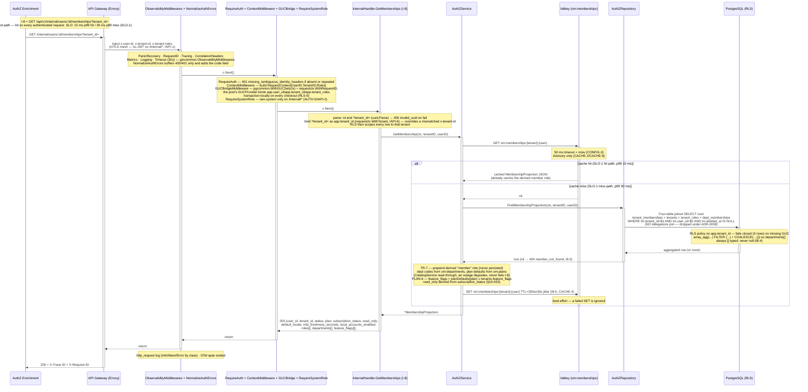

**Middleware execution model.** The router (`internal/adapter/inbound/http/router.go`, `NewRouter`) is the single source of truth for every path, method, and middleware — shared by `cmd/server/main.go` and `test/e2e/harness_test.go`, so the two can never drift the way a hand-copied route table historically did:

```
1 MB body cap (inline func)
  gincommon.ObservabilityMiddlewares (PanicRecovery · RequestID · Tracing · CorrelationHeaders · Metrics · Logging · Timeout(Config.RequestTimeout = 30s, innermost))
      NormalizeAuthErrors()                      — G-13: buffers only 400/401s; adds missing_/ambiguous_identity_headers / invalid_request_context `code`
        [/api/v1 group] gincommon.ProtectedMiddlewares (RequireAuth · ContextMiddleware)
          GUCBridgeMiddleware                    — pgcommon.WithGUCSet(ctx) + requestctx.WithRequestID, RLS-6
            RequireJSONContentType               — 415 on a non-JSON POST/PUT/PATCH body
              [/tenants group] RequireActiveTenant · RequireActiveMembership   — TRIAL-4/§16 A53, public routes only
              [/operator group] RequireOperatorRole                            — AUTH-6
              [/internal group] RequireSystemRole                              — AUTH-5/IAPI-2
                Handler ← executes here
```

`/healthz` and `/readyz` (`registerInfraRoutes`) and the docs surface (`registerDocsRoutes`, gated by `DocsConfig.active()`) are registered **before** this chain, so a load-balancer probe with no headers still gets `200`. `/healthz` is pure liveness — it never inspects a dependency; `/readyz` checks the app Postgres pool, the `sysPool` (BYPASSRLS, a separate physical connection so a credential rotation on that role alone is caught), Valkey, the outbox runner (`select` on its `Ready()` channel), and one heartbeat per wired SQS consumer (a consumer goroutine that exits marks itself dead), returning `503` on any failure. `RequireActiveTenant`/`RequireActiveMembership` bypass `iam-system` and `platform_operator` principals — those internal/operator control paths must be able to reach a `trial_expired`/`suspended` tenant to restore it.

---

## Pre-login tenant/realm resolution (PUB-1)

`GET /api/v1/public/tenants/resolve?identifier=` answers one question for an anonymous browser that has no tenant or realm context yet: which Keycloak realm should the sign-in redirect go to (IAM HLD §8.2.7, LLD §5.4/§8.11). It's the only route in this service with no authentication.

- **No auth, no headers.** `registerPublicRoutes` registers it directly on the gin engine, outside the protected `/api/v1` group. It still gets the engine-level body cap, timeout and observability middleware, but never `RequireAuth`, `GUCBridgeMiddleware` or a role gate (PUBRES-1). Envoy routes it past `ext_authz`, which is still platform config to land (LLD §16 OQ-10).
- **No GUC, so `sysPool`.** With no `app.tenant_id` bound, the RLS-scoped app pool would fail closed and return no rows for every lookup. `TenantResolutionService` therefore sits on the BYPASSRLS `sysPool` repository, the same one I-16 uses.
- **What resolves.** A company slug (any live tenant), or the email of a still-pending, unexpired invitation. An already-active member's email doesn't resolve, because this service stores no email for active members (LLD §16 OQ-11, option A). A slug match wins over an email match. It's one SQL statement over `uq_tenants_slug` and `idx_pi_email_pending`.
- **Constant shape (PUBRES-2).** Always `200`: `{found, realm, strategy}` for a dedicated tenant, plus `tenant_id` for a shared (trial) tenant (PUBRES-4), and exactly `{found:false}` for no match. Never `404`.
- **No cache, no event, no write.** Every call reaches Postgres (§6.1), which keeps the anti-enumeration property easy to reason about. The metric is `iam_org_membership_public_tenant_resolve_total{result=found|not_found}`.

> Source: [`docs/architecture/mermaid/public-tenant-resolve-flow.mmd`](docs/architecture/mermaid/public-tenant-resolve-flow.mmd)

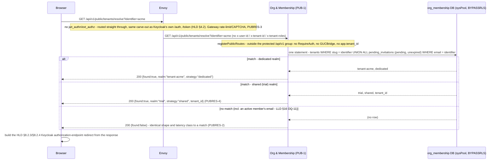

---

## Write flow and transactional outbox

Every mutating operation commits its business-table write and its outbox event(s) inside **one** `pgcommon.RunInTx` — no event without state, no committed state without an event (EVT-10, CONS-1). Unlike Realm Provisioner's Keycloak-effect-first discipline, this service's writes are pure Postgres transactions from the caller's perspective, and no outbound HTTP call ever runs while a transaction is open. The Realm Provisioner calls sit outside it: invite's `CreateInvitedUser` runs **before** the local transaction, with a commit failure afterwards compensated durably through `kc_cleanup_pending` and the `invitation-kc-cleanup` CronJob (PI-9); removal's `RevokeUserSessions` runs **after** commit, best-effort (AUTH-8). The diagram uses P-10, whose pre-transaction checks (Token Service, Catalog, the §8.8.4 demotion gate) follow the same rule.

> Source: [`docs/architecture/mermaid/write-flow.mmd`](docs/architecture/mermaid/write-flow.mmd)

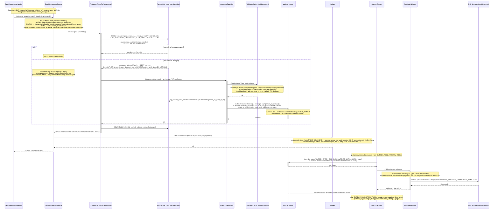

`Publisher.Enqueue` (`internal/adapter/outbound/eventbus/publisher.go`) marshals the payload, runs it through the `ValidatingCodec` for **schema validation only** (the returned bytes are discarded — the outbox always stores plain JSON), builds an `events.Envelope` carrying `tenant_id`/`trace_id`/`ip_address`/`user_agent`/`actor`/`subject`, and inserts it against the `pgx.Tx` it retrieves from `port.TxFromContext(ctx)` — the same transaction `TxRunner.RunInTx` opened for the business write. An event with a `subject` goes through `outbox.EnqueueOrdered` keyed `<tenant_id>/<subject>`, after the transaction takes `pg_advisory_xact_lock(hashtextextended('outbox-order:<key>', 0))` so two transactions enqueuing for one key never interleave (the library's precondition); one without a subject uses plain `outbox.Enqueue`. The runner then publishes one key's records one at a time, in commit order. That ordering stops at SNS: topics and queues are standard, so consumers keep their own recency guards. `TxRunner.RunInTx` (`internal/adapter/outbound/postgres/db.go`) additionally retries the whole callback on deadlock/serialization failure via `pgcommon.RunInTxWithRetryOpts` (3 attempts, 10 ms → 500 ms exponential backoff with 25% jitter) and maps any surviving connection-level error to `domain.ErrDBUnavailable` (503) through `wrapConnErr`, so a handler's error branch never has to special-case a transport failure.

---

## Provisioning flow

Tenants enter the system through **I-1**, called by the Signup BFF after Realm Provisioner has created the realm/owner in Keycloak. If that call never completes, RP's `TenantIdentityProvisioned` event (consumed on `tenant-orgm-q`) runs the same I-1 flow from its payload — the signup provisioning backstop; when the BFF's I-1 got there first it is a no-op (LLD rev 2.33).

> Source: [`docs/architecture/mermaid/provisioning-flow.mmd`](docs/architecture/mermaid/provisioning-flow.mmd)

```mermaid
sequenceDiagram
    participant Caller as Signup BFF / Realm Provisioner
    participant H as InternalHandler.ProvisionTenant (I-1)
    participant TSVC as ProvisioningService.TrialSignup
    participant Catalog as CatalogService (read-through to Catalog Service)
    participant TX as TxRunner.RunInTx
    participant DB as PostgreSQL (org_membership)
    participant OB as outbox_events
    participant Router as RoutingPublisher
    participant SNS_T as SNS iam.tenant.events
    participant SNS_M as SNS iam.membership.events
    participant EC as MembershipEventConsumer (tenant-orgm-q)

    Note over Caller,H: Trial signup path (§8.1) — the caller has created the realm + owner in Keycloak,<br/>then calls I-1 over the internal mesh (iam-system role). Every tenant is created trial-shaped.

    Caller ->>+ H: POST /api/v1/internal/tenants {tenant_id, slug, name, plan, owner_user_id, default_locale}
    Note over H: required fields + plan whitelist (422 invalid_plan)
    H ->>+ TSVC: TrialSignup(ctx, TrialSignupInput)
    Note over TSVC: slug / name / locale validation (GAP-I1-*)

    TSVC ->>+ Catalog: PlanByCode(plan) — trial_duration_days
    Catalog -->>- TSVC: plan
    TSVC ->>+ Catalog: Departments() — filter to the 5 system depts (is_active)
    Catalog -->>- TSVC: departments
    Note over TSVC,Catalog: Both calls happen BEFORE the tx opens — an HTTP call has no<br/>business running while a Postgres tx is open. Catalog is NOT fail-open:<br/>cold cache + Catalog down → 503 catalog_unavailable, nothing written.

    TSVC ->>+ TX: RunInTx(gucCtx) — GUC bound to the new tenant + iam-system (RLS-5)

    TX ->>+ DB: (1) INSERT tenants (id, slug, plan, status=trial, trial_ends_at, ...)<br/>ON CONFLICT (id) DO NOTHING
    DB -->>- TX: inserted, or existed
    alt tenant already existed (idempotent replay)
        Note over TX,DB: no re-seed, no events — short-circuit, handler answers 200
    else fresh insert
        TX ->>+ DB: (2) tenant_departments — activate Engineering · Design · Procurement · Finance · Legal
        DB -->>- TX: 5 rows
        TX ->>+ DB: (3) dept_role_labels.Seed — preparator · reviewer · approver
        DB -->>- TX: 3 rows
        TX ->>+ DB: (4) INSERT tenant_memberships (owner, status=active)
        DB -->>- TX: 1 row
        TX ->>+ DB: (5) INSERT tenant_roles (owner, role_code=tenant_owner,<br/>granted_by = owner_user_id) — I1-3, TM-8, TR-8
        DB -->>- TX: 1 row
        TX ->>+ OB: (6a) Enqueue TenantCreated {tenant_id, slug, plan, status} — key {tenant_id}/{tenant_id}
        OB -->>- TX: inserted
        TX ->>+ OB: (6b) Enqueue TrialStarted {tenant_id, plan, trial_ends_at} — key {tenant_id}/{tenant_id}
        OB -->>- TX: inserted
        TX ->>+ OB: (6c) Enqueue TenantRoleGranted {owner grant} — key {tenant_id}/{owner_user_id}
        OB -->>- TX: inserted
    end
    TX ->> DB: COMMIT — all steps atomic (FAIL-1)
    TX -->>- TSVC: ok

    TSVC -->>- H: tenant, wasCreated
    H -->>- Caller: 201 (created) / 200 (replay)

    Note over Router,SNS_M: Outbox runner publishes, RoutingPublisher routes by domain.TopicForEvent(type)
    Router ->> SNS_T: TenantCreated, TrialStarted (Core's only two produced events on this topic, §7.3)
    Router ->> SNS_M: TenantRoleGranted

    Note over EC: Backstop: RP's TenantIdentityProvisioned on tenant-orgm-q runs this same I-1 flow<br/>(ProvisioningService.TrialSignup) when no tenant row exists — the BFF's call never completed;<br/>a no-op when the row exists (ON CONFLICT (id) DO NOTHING; first writer wins). Core does not<br/>consume its own TenantCreated/TrialStarted (HLD §9.1.1 disjoint produce/consume sets).
```

`TrialReactivated` (a `billing-orgm-q` event, not shown above) follows the same shape but resolves `plan.trial_duration_days` via a pre-tx `port.PlanCatalogReader.PlanByCode` call — this mirrors `TrialSignup`'s own pattern and was a deliberate fix: an earlier version of this handler read a local `plans` table subquery that no longer exists post-ADR-0007, which failed on every occurrence until integration tests (added specifically to close that gap) caught it. `AddMember` (I-3, both the SAML JIT-add path and the invitation-acceptance path) and `AssignFromGroups` (I-10) share the same RunInTx-then-outbox discipline; I-10's group→role resolution itself is a `GroupMappingService` client call made **before** the transaction opens, exactly like the two Catalog calls above.

---

## Delegation touchpoints

Core owns **no** `delegations` table and runs no OOO-coordination flow — that entire domain moved to the standalone Delegation Service (ADR-0008). What remains are narrow, read-only lookups made before any transaction opens. Full removal (P-8) is fail-closed on the Workflow Service (`503 workflow_service_unavailable`). The department paths degrade instead: a Delegation outage on P-11 falls back to tenant-wide impact scoping, a Delegation or Workflow outage on a P-10 demotion allows the decrease (WFI-9), and a Workflow error on P-11 lets the removal proceed. I-5 (`ProvisioningService.DeleteMember`, the IdP-driven delete) has no Workflow gate.

> Source: [`docs/architecture/mermaid/ooo-delegate-flow.mmd`](docs/architecture/mermaid/ooo-delegate-flow.mmd)

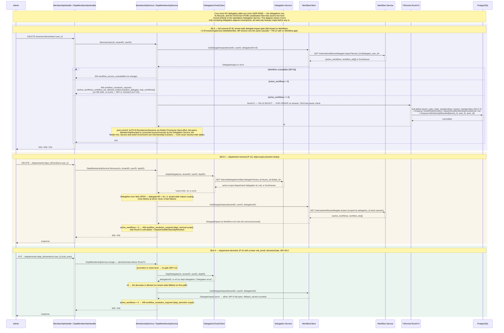

---

## Cache strategy

Valkey is **advisory-only** (CACHE-2/CACHE-9) end to end — a miss, timeout, or outage always falls through to Postgres or the owning upstream service; it never becomes the source of truth for a request. `valkey.New` hardcodes tight timeouts (100 ms dial, 50 ms read/write) rather than reading an env var, on the theory that a slow cache must degrade to a fast miss, not stall the request.

> Source: [`docs/architecture/mermaid/cache-strategy.mmd`](docs/architecture/mermaid/cache-strategy.mmd)

```mermaid
flowchart TD
    subgraph keys["Working Caches — Get+Set (Valkey — ElastiCache via go-redis/v9)"]
        k1["om:memberships:{tenant}:{user}\n→ Full I-8 response (4-table join: status/plan/locale/roles/departments)\nNo active_delegations — dropped under ADR-0008\nTTL: 300 s ± 30 s jitter (CACHE-4, I8-5)"]
        k2["om:tenant:{tenant}\n→ Tenant row (plan, locale, feature_flags, mfa_freshness)\nTTL: 600 s"]
        k3["om:plans (+ om:plans:stale)\n→ Read-through from Catalog Service (catalogadmin client)\nPrimary TTL 600 s; :stale is a SEPARATE 24h-TTL key,\nrefreshed alongside primary, served only when both\nthe primary miss AND the live Catalog call fail"]
        k4["om:departments (+ om:departments:stale)\n→ Read-through from Catalog Service, same 600s/24h two-tier pattern as om:plans"]
        k5["om:grm / om:gdm / om:gtrm {tenant}\n(+ :stale variants)\n→ Read-through from Group Mapping Service (I-10 JIT resolution)\nSame 600s primary / 24h stale-if-error two-tier pattern"]
        k6["om:seat_usage:{tenant}\n→ P-27 / I-11 SeatUsage projection (active + pending vs licensed_seats)\nTTL: 30 s (CACHE-5), evicted by every SEAT-1 mutator"]
    end

    subgraph declared["Declared but NOT populated — invalidated on write, never Get/Set (§6.1)"]
        d1["om:members:{tenant}:{limit} — P-4 list handler always reads Postgres directly"]
        d2["om:roles:{tenant} — no read path checks this key"]
        d3["om:locale:{tenant} — I-9 reads through om:tenant instead; this key is vestigial"]
        d4["om:dept_members:{tenant}:{dept} — zero call sites anywhere, not even DEL"]
    end

    subgraph read["Read Path (I-8 hot path shown; all other reads mirror)"]
        R1([GET /internal/users/:id/memberships]) --> R2{Cache hit?}
        R2 -- yes --> R3[Decode JSON — the derived 'member' role was injected before caching\nReturn immediately\nSLO 15 ms p99]
        R2 -- no or 50 ms timeout --> R4[Four-table joined SELECT\ntenant_memberships + tenants + tenant_roles + dept_memberships\nRLS enforces tenant isolation on app.tenant_id]
        R4           --> R5[Back-fill cache with TTL jitter ±30 s\nprevents thundering herd on deploy restart]
        R5           --> R6[Return entity\nSLO 30 ms p99]
    end

    subgraph write["Write / Invalidation Path (post-commit only, CACHE-6)"]
        W1([P-6 invite / P-8 remove / P-10·P-11 dept assign·remove / P-28 role reconcile / I-4 status / O-7]) --> W2["RunInTx {\n  UPDATE business row\n  INSERT outbox_events\n}"]
        W2 --> W3{Committed?}
        W3 -- no → rollback --> W4[No cache operation\ntransaction error returned]
        W3 -- yes --> W5["DEL affected keys (CACHE-7):\nDEL om:memberships:{t}:{user} — P-28 role reconcile, I-4 status, O-7 new owner only\n  (P-8 relies on AuthZ Enrichment evicting on MembershipRevoked; P-10/P-11 rely on the 300s TTL)\nDEL om:seat_usage:{t} (working cache, 30 s)\nDEL om:members:{t}:50 / om:dept_members:{t}:{dept}\n  (declared-only keys — this DEL currently evicts nothing that was ever set)\nbest-effort — failure logged, TTL heals"]
        W5 --> W6[Return updated entity\nNext read repopulates the working caches only]
    end

    subgraph tenantwipe["Tenant Offboarding Cache Wipe (CACHE-8, §15.5)"]
        O1([TenantOffboarded consumed on tenant-orgm-q]) --> O2["One tx: GDPR wipe of Core's own rows (soft-delete + scrub)\n+ Enqueue TenantMembershipsPurged{tenant_id, actor_id} on iam.membership.events\n(consumed by Delegation/Tender-ACL/Group-Mapping for THEIR OWN tenant-scoped cascades)"]
        O2 --> O3["Post-commit, best-effort DEL of the bounded tenant keys:\nom:tenant · om:locale · om:roles · om:seat_usage · om:members:{t}:50\nom:grm / om:gdm / om:gtrm (+ :stale)"]
        O3 --> O4["NOT enumerated: om:memberships:{t}:{user} and om:dept_members:{t}:{dept}\n(unbounded families — they expire on their own TTL, no SCAN-based prefix delete)"]
    end

    subgraph ttl["TTL Self-Healing (CACHE-9, FAIL-2)"]
        T1[Cache unavailable / DEL fails / 50 ms timeout] --> T2["Advisory — Postgres (or, for read-through keys, the owning service) is source of truth"]
        T2 --> T3["Stale entry expires at TTL boundary\nNext read fetches from source and re-populates"]
        T3 --> T4["/readyz fails on a Valkey outage, pulling the pod from rotation;\nrequests already in flight still fall through to Postgres"]
    end

    note1["CACHE-1 — All tenant-scoped keys are tenant-prefixed (mirrors RLS boundary); om:plans/om:departments are deliberately tenant-agnostic global catalogs\nCACHE-2 — Cache advisory only; miss/timeout falls through to Postgres or the owning service\nCACHE-4 — Jitter ±30 s prevents thundering herd on many-key expiry\nNo Valkey timeout env var — 50ms read/write / 100ms dial hardcoded in valkey.New's client options"]
```

Note the honest gap this diagram documents: four key builders exist on `valkey.Cache` (`MembersPageKey`, `RolesKey`, `LocaleKey`, `DeptMembersKey`) with no corresponding read path — some handlers `DEL` them post-commit (so a future read path would invalidate correctly if wired), but nothing ever `Get`s or `Set`s them today. This is not a correctness bug (Postgres is always consulted directly instead), just an unfinished caching layer for those four endpoints. `om:seat_usage` is no longer one of them: `MembershipService.SeatUsage` (P-27/I-11) reads and writes it with a 30 s TTL. Also note that `om:memberships` is evicted only by P-28 role reconcile, I-4 status changes and O-7. P-8 relies on AuthZ Enrichment evicting on `MembershipRevoked`, and the department paths (P-10/P-11) rely on the 300 s TTL.

---

## Data model

Database `org_membership` on shared RDS PostgreSQL (Multi-AZ, PgBouncer transaction pooling). **8 tables**, RLS via the `app.tenant_id` GUC on the 7 tenant-scoped ones — no cross-database foreign keys (the composite FKs the ADR-0007/ADR-0008 decomposition lost are replaced by app-level checks against read-through caches, or by other services' new I-15 existence check, described below the diagram). Since this service has never been deployed, the schema is one consolidated migration (`000000_initial_schema`) rather than an incremental history with dead expand/contract steps to carry forward, followed by three additive ones: `000001_check_constraints`, `000002_pub1_pending_invitations_email_idx` (PUB-1's pending-email index), and `000003_cd37_residency_mode` (`tenants.residency_mode TEXT NOT NULL DEFAULT 'standard'`, CD-37). `processed_events.event_id` is `uuid`, the shape platform-events' inbox requires.

> Source: [`docs/architecture/mermaid/data-model.mmd`](docs/architecture/mermaid/data-model.mmd)

```mermaid
erDiagram
    tenants {
        uuid id PK
        text slug UK "immutable (T-1)"
        text name
        tenant_plan plan "ENUM starter-pro-enterprise, no local FK — validated against Catalog Service (om:plans)"
        jsonb feature_flags "override delta only, not the effective set (T-9)"
        subscription_status status "ENUM trial-active-past_due-cancelled-suspended-trial_expired-offboarded"
        timestamptz trial_ends_at "required for trial/trial_expired (T-4)"
        int trial_reactivation_count "0..1 cap (T-14)"
        timestamptz subscription_started_at "required for paid statuses (T-5)"
        timestamptz cancelled_at "biconditional with status, CASE'd by suspension_source (T-11/T-16)"
        suspension_source suspension_source "ENUM billing_lapse-operator, non-NULL iff status=suspended (T-16)"
        timestamptz last_event_at "EVT-14 recency high-water mark"
        text realm_id "unique WHERE realm_type=dedicated (T-6)"
        realm_type realm_type "ENUM shared-dedicated, explicit not derived (T-6)"
        text keycloak_shard "RP-owned projection, O&M never selects (T-12)"
        int mfa_freshness_seconds "60..900 (T-10)"
        boolean local_accounts_enabled
        boolean realm_sync_pending "T-15 Option A reconcile marker"
        text default_locale "BCP-47"
        int licensed_seats "SEAT-1 cap, must be positive (T-8)"
        timestamptz ownerless_since "set by TM-12, cleared only by O-7 (T-13)"
        timestamptz overage_since "SEAT-5"
        bigint record_version "optimistic lock, DB-owned (TRG-1)"
        timestamptz created_at
        timestamptz updated_at
        timestamptz deleted_at "GDPR wipe only (T-7)"
    }
    tenant_departments {
        uuid tenant_id PK "composite PK with department_id, no separate id — also FK to tenants (TD-7)"
        uuid department_id PK "external — global catalog lives in Catalog Service, no local FK"
        boolean is_active
        bigint record_version
        timestamptz created_at
        timestamptz updated_at
    }
    tenant_memberships {
        uuid id PK
        uuid tenant_id FK
        uuid user_id "Keycloak sub"
        membership_status status "ENUM active-suspended-left, lifecycle only — no role data (§16 A14)"
        bigint record_version
        timestamptz created_at
        timestamptz updated_at
        timestamptz deleted_at "GDPR wipe only (TM-5)"
    }
    tenant_roles {
        uuid id PK
        uuid tenant_id FK
        uuid user_id
        uuid tenant_membership_id FK "composite (id,tenant_id,user_id) -> tenant_memberships, TR-8"
        tenant_role role_code "ENUM tenant_owner-tenant_admin-tender_admin, 'member' barred at DB level (TR-7)"
        uuid granted_by "granter's Keycloak sub, audit only"
        bigint record_version
        timestamptz created_at
        timestamptz updated_at
        timestamptz deleted_at "soft-delete on revoke"
    }
    dept_memberships {
        uuid id PK
        uuid tenant_id FK
        uuid user_id
        uuid tenant_membership_id FK "composite (id,tenant_id,user_id) -> tenant_memberships, DM-4"
        uuid department_id FK "composite (tenant_id,department_id) -> tenant_departments — user can only be assigned to an activated dept"
        dept_role role_level "ENUM preparator-reviewer-approver"
        uuid granted_by "'iam-system' UUID for JIT grants (DM-5)"
        bigint record_version
        timestamptz created_at
        timestamptz updated_at
        timestamptz deleted_at
    }
    dept_role_labels {
        uuid id PK
        uuid tenant_id FK
        dept_role role_code UK "ENUM, paired with tenant_id for uniqueness"
        text display_name "presentation only, no group-mapping data (DRL-2)"
        bigint record_version
        timestamptz created_at
        timestamptz updated_at
    }
    pending_invitations {
        uuid id PK
        uuid tenant_id FK
        citext email "case-insensitive — one PII exception, cleared at acceptance"
        text full_name "second PII exception, cleared at acceptance"
        tenant_role_array initial_tenant_roles "native ENUM array, not jsonb"
        jsonb initial_dept_mappings "[{department_id, level}], applied on acceptance"
        uuid invited_by "inviting admin's Keycloak sub"
        uuid keycloak_user_id "set post-RP CreateInvitedUser, nullable until then"
        invitation_status status "ENUM pending-accepted-expired-revoked (§16 A11)"
        timestamptz expires_at "default 7d, coupled to INVITATION_EXPIRY_DAYS / KC action-token lifespan"
        timestamptz accepted_at "biconditional with status=accepted (PI-2)"
        boolean kc_cleanup_pending "saga-compensation marker for invitation-kc-cleanup CronJob (PI-9)"
        bigint record_version
        timestamptz created_at
        timestamptz updated_at
    }
    processed_events {
        uuid event_id PK "envelope id (UUID, platform-events inbox shape), SQS dedup"
        text consumer PK "iam-org-membership or catalog — two independent dedup buckets"
        timestamptz processed_at
    }

    tenants ||--o{ tenant_departments  : "fk_td_tenant, ON DELETE CASCADE"
    tenants ||--o{ tenant_memberships  : "fk_tm_tenant, ON DELETE CASCADE"
    tenants ||--o{ tenant_roles        : "fk_tnr_tenant, ON DELETE CASCADE"
    tenants ||--o{ dept_memberships    : "fk_dm_tenant, ON DELETE CASCADE"
    tenants ||--o{ dept_role_labels    : "fk_drl_tenant, ON DELETE CASCADE"
    tenants ||--o{ pending_invitations : "fk_pi_tenant, ON DELETE CASCADE"
    tenant_memberships ||--o{ tenant_roles     : "fk_tnr_tenant_membership, composite (id,tenant_id,user_id)"
    tenant_memberships ||--o{ dept_memberships : "fk_dm_tenant_membership, composite (id,tenant_id,user_id)"
    tenant_departments ||--o{ dept_memberships : "fk_dm_tenant_dept, composite (tenant_id,department_id)"
```

`rls_violation_log` also exists (not a business table — a 1%-sampled RLS-disabled audit sink written by `log_rls_violation()`, disabled specifically so its own insert can't recurse into a policy check) and is omitted from the ER diagram for that reason, same convention as `iam-delegation`'s own data model.

7 of the 8 tables carry `record_version` (all but `processed_events`), bumped by the shared `touch_row()` `BEFORE UPDATE` trigger, guarded by `WHEN (OLD.* IS DISTINCT FROM NEW.*)` so a no-op write never spuriously advances the version or triggers a redundant event (TRG-1/TRG-3). Partial unique indexes (`WHERE deleted_at IS NULL` on `tenant_memberships`/`tenant_roles`/`dept_memberships`, `WHERE status = 'pending'` on `pending_invitations`) let a user rejoin a tenant or department previously left.

**Three Postgres roles** (`rls_check_tenant`/`app_tenant_id` are the enforcement functions the policies call):

| Role | Grants | Used by |
|---|---|---|
| `org_membership_app` | Normal DML, RLS-scoped, **never** `BYPASSRLS` (RLS-4 — the migration's final `DO $$` block actively strips `BYPASSRLS` if ever found set, and warns if it lacks privilege to fix it itself) | The running server pod's app pool |
| `org_membership_migrator` | `BYPASSRLS`, DDL | Migrations, `sysPool` (reconciler jobs, business-metric exporters, I-16's cross-tenant read) |
| `admin_readonly` | `NOLOGIN BYPASSRLS`, `SELECT` only | Cross-tenant compliance/support reads — never used by application code |

Some cross-database foreign keys were lost in the decomposition and replaced by synchronous app-level checks: `tenants.plan` and `tenant_departments.department_id`/`dept_memberships.department_id` are validated against the `om:plans`/`om:departments` read-through cache rather than a local FK, and Tender ACL / Delegation now call this service's I-15 existence check instead of a composite membership FK that would have had to span two databases.

Full table catalogue, enums, and every RLS/tenant/seat/migration/trigger invariant is in [`.claude/database-schema.md`](.claude/database-schema.md).

---

## Event and outbox flow

Two outbound SNS topics via `RoutingPublisher` — this service's own local type, routing each envelope by `domain.TopicForEvent(env.Type)` (event **type**, not `Envelope.Source`) to one of two pre-built publisher fields. This is this service's structural departure from a single-topic publisher, and the reason a local wrapper exists rather than reaching for `platform-events`' `NewSNSPublisher` directly. `PublishBatch` always publishes both lanes and merges their failures into one `*events.BatchError`, because the runner marks every record not listed as failed as published. A record that exhausts `OUTBOX_MAX_ATTEMPTS` moves to platform-events' `outbox_dead_letters` table; replay goes through `outbox.Runner.ReprocessDeadLetters`, never hand-written SQL ([`docs/runbook-outbox-dead-letter.md`](docs/runbook-outbox-dead-letter.md)).

The inbound side lives in `internal/adapter/inbound/sqspipeline`, outside `cmd/server`, so `test/integration/pipeline_dlq_test.go` runs the production pipeline against floci. `NewConsumer` builds the platform-events consumer with `events.GlueDecodeCodec` and `events.WithDLQForwarding`, using `EnvForQueue`'s defaults (`SQS_MAX_RECEIVE_COUNT` 4, `SQS_DRAIN_TIMEOUT` 15s, `SQS_HANDLER_TIMEOUT` 20s, `SQS_QUEUE_DEPTH_INTERVAL` 60s). `Handler` composes DLQ router → consumer span → `validateConsumed` → `Handle`. `RequireDLQ` makes a queue without a RedrivePolicy fatal at startup. Inside `Handle`, `consumer/dedup.go`'s `processOnce` claims the event in `processed_events` (platform-events `inbox.Store.Process`, via `postgres.InboxRepository`) first, in the same transaction as the handler's writes, so a concurrent duplicate waits on the claim's row lock and is then skipped.

> Source: [`docs/architecture/mermaid/event-outbox-flow.mmd`](docs/architecture/mermaid/event-outbox-flow.mmd)

```mermaid
sequenceDiagram
    participant SVC as core/service
    participant TX as TxRunner.RunInTx
    participant DB as PostgreSQL (business table)
    participant VC as ValidatingCodec (enqueue — validation only)
    participant OB as outbox_events
    participant Runner as Outbox Runner (platform-events, poll 500 ms)
    participant Router as RoutingPublisher (own local type)
    participant Pub as SNS publisher + GlueCodec (per topic)
    participant SNS as SNS iam.membership.events / iam.tenant.events
    participant SQS as SQS subscribers (§7.3.2 fan-out)
    participant Q as Inbound SQS (tenant-orgm-q / billing-orgm-q / catalog-orgm-q)
    participant PE as platform-events SQS consumer (sqspipeline.NewConsumer)
    participant Pipe as sqspipeline.Handler (DLQ router → consumer span → validateConsumed)
    participant H as MembershipEventConsumer / CatalogConsumer
    participant DLQ as queue -dlq (per queue)

    Note over SVC,OB: Phase 1 — Atomic write + event enqueue (same transaction, EVT-10 / CONS-1)

    SVC ->>+ TX: RunInTx(ctx, func(txCtx))
    TX ->> DB: UPDATE / INSERT business row (record_version optimistic lock, TRG-1)
    TX ->> VC: Publisher.Enqueue → Encode(event.Type, jsonPayload)
    Note over VC: Validates against embedded schemas/*.json — fail-closed:<br/>invalid payload or type with no schema → error → whole TX rolls back.<br/>Wraps NoopCodec: no wire encoding here, bytes discarded.
    alt schema validation fails
        VC -->> TX: error
        TX ->> DB: ROLLBACK (no orphan business write, no orphan outbox row)
    else validation passes
        VC -->> TX: ok
        TX ->> DB: event has a subject → pg_advisory_xact_lock(hashtextextended('outbox-order:{tenant_id}/{subject}', 0))<br/>so two writers for one key never interleave (held to commit)
        TX ->> OB: outbox.EnqueueOrdered(key {tenant_id}/{subject}) — or outbox.Enqueue when no subject<br/>PLAIN-JSON envelope (id UUID v7, type, source=iam-org-membership, tenant_id, subject, actor, trace_id)
        TX ->> DB: COMMIT — business row + outbox row durable together
    end
    TX -->>- SVC: result

    Note over Runner,SQS: Phase 2 — Outbox polling + routed SNS publish (at-least-once, FAIL-3)

    loop every OUTBOX_POLL_INTERVAL
        Runner ->> OB: claim due batch (FOR UPDATE SKIP LOCKED + lease, OUTBOX_CLAIM_LEASE_DURATION)<br/>records of one ordering key publish one at a time, in enqueue order
        Runner ->>+ Router: PublishBatch(envelopes)
        Note over Router: domain.TopicForEvent(env.Type) — event TYPE, not Envelope.Source.<br/>TenantCreated / TrialStarted → tenant lane, all 12 others → membership lane.<br/>Both lanes always publish, their failures merge into one *events.BatchError.
        Router ->>+ Pub: PublishBatch(lane envelopes)
        Note over Pub: GlueCodec.Encode — version UUID from an in-memory cache,<br/>resolved ONCE at startup via glue:GetSchemaByDefinition with this<br/>build's embedded schema (never "latest", no refresher, no per-event Glue call).<br/>Payload → [0x03][0x00][16-byte UUID] + JSON, base64 into data, dataschema = UUID.<br/>NoopCodec (plain JSON) when GLUE_REGISTRY_*_NAME is unset.
        Pub ->> SNS: Publish (MessageAttributes EventType, traceparent, …)
        Pub -->>- Router: ok / failures
        Router -->>- Runner: nil or *events.BatchError
        Runner ->> OB: mark published_at for every record not listed as failed
        alt publish fails
            Runner ->> OB: attempts++ with backoff — after OUTBOX_MAX_ATTEMPTS (5) the record moves to outbox_dead_letters<br/>(platform_dlq_messages_total{operation=outbox_publish} pages, replay via Runner.ReprocessDeadLetters)
        end
    end
    SNS ->> SQS: fan-out filtered by EventType (6 membership subscribers, 2 tenant)
    Note over SNS,SQS: Delivery is NOT ordered end to end (standard topics/queues, concurrent consumers) —<br/>consumers keep their own recency guards (EVT-14).

    Note over Q,DLQ: Phase 3 — This service's own inbound pipeline (per queue, outermost first)

    Q ->>+ PE: ReceiveMessage (long poll)
    PE ->> PE: unmarshal envelope — malformed → original forwarded to DLQ (DLQPublisher), then deleted
    opt dataschema set (producer used a Glue codec)
        PE ->> PE: events.GlueDecodeCodec.Decode — strip 18-byte header, no registry lookup
    end
    PE ->>+ Pipe: handler(env)
    Pipe ->> Pipe: validateConsumed — embedded consumed schema for env.Type<br/>(no schema → pass through to ackUnknown)
    alt schema violation
        Pipe ->> DLQ: DLQPublisher.SendToDLQ — original body + attributes,<br/>DLQReason=schema_violation
        Note over Pipe: iam_org_membership_consumed_event_rejected_total{reason="schema_violation"}++<br/>IAMConsumedEventSchemaViolation pages
    else valid
        Pipe ->>+ H: Handle(env) — EVT-15 clamp first, then processOnce: inbox claim on processed_events,<br/>then EVT-14 recency / projection / EVT-16 relay in the SAME tx
        alt EVT-15 future-time clamp (ErrPoisonPill)
            H -->> Pipe: ErrPoisonPill (before any tx — processed_events NOT recorded)
            Pipe ->> DLQ: DLQPublisher.SendToDLQ — original message, DLQReason=future_time_clamp
        else projected / stale-skipped / unknown type / duplicate
            H -->> Pipe: nil (claim committed with the writes, a duplicate waits on the claim's row lock, then skips)
        else transient error
            H -->>- Pipe: error (tx rolled back, claim released)
        end
    end
    Pipe -->>- PE: nil (acked) or error (left visible)
    alt nil
        PE ->> Q: DeleteMessage
    else error — normal retry
        Note over PE,DLQ: redelivered — at receive count 4 (SQS_MAX_RECEIVE_COUNT) platform-events forwards the original to -dlq,<br/>SQS redrive at maxReceiveCount = 5 is the backstop (EVT-5). Same path if a forward fails.
    end
    deactivate PE
```

`GlueCodec` is scoped one-per-topic (`internal/adapter/outbound/eventbus/glue_codec.go`) — `cmd/server/main.go` splits the embedded `schemas/*.json` file set into the membership/tenant lists via `domain.TopicForEvent`, so the two Glue registries (`GLUE_REGISTRY_MEMBERSHIP_NAME`/`GLUE_REGISTRY_TENANT_NAME`) can never end up requesting a schema name from the wrong registry. Unlike some sibling services, this repo's event `Type` strings (e.g. `DepartmentMembershipGranted`) already are the exact PascalCase Glue schema name — no dot-notation translation step exists. Version UUIDs are resolved once at startup **by definition** (`glue:GetSchemaByDefinition` with the binary's own embedded schema, sent in the exact compact form `schema-gov register` uploads), not as the registry's latest — so each build stamps the version that actually describes its payloads, correctly through deploy/registration races and rollbacks. There is no refresher: the UUID is fixed per process. A definition not yet registered fails startup (CrashLoop until `schema-registry.yml` lands it).

---

## Observability stack

Two observability concerns run per request: Prometheus metrics (synchronous, in-process) and OpenTelemetry spans (async, OTLP export to `OTEL_EXPORTER_OTLP_ENDPOINT`; in gincommon v1.6.0 an empty value falls back to `localhost:4317`, so export cannot be switched off yet). `gincommon.ObservabilityMiddlewares` and `metrics.Register(environment)` are wired once in `cmd/server/main.go`, before any collector registration, so business/events/pgcommon metrics land on the same `gincommon.MetricsRegisterer()` and one `/metrics` scrape (on the dedicated `METRICS_PORT`, never sharing a listener with the API surface) serves HTTP + business + outbox + pg collectors together, through `gincommon.MetricsHandler()` (ContinueOnError: one failing collector does not blank the scrape). Reconciler CronJobs are never scraped and push each run's metrics to `PROMETHEUS_PUSHGATEWAY_URL`. Metrics follow the IAM Platform Observability Standard's three tiers. Tier 1 `platform_*` comes from the libraries, and the three this service also records into (`platform_dlq_messages_total`, `platform_duplicate_messages_total`, `platform_dependency_request_seconds`) are built from the registry with `gincommon.NewShared*Vec`. Tier 2 `iam_*` (four registry entries since gincommon v1.6.0, status proposed) is built the same way. Tier 3 `iam_org_membership_*` is built with `gincommon.NewCounterVec`/`NewGauge`/`NewHistogramVec`, which validate the name and inject the `domain`/`service`/`environment` const labels. `metrics.Register` is a no-op until gincommon is initialised. CI runs platform-gincommon's `metricslint` on a real scrape (`make metrics-lint`, `.github/scripts/metricslint.sh`), and `make metrics-inventory` regenerates [`docs/observability/metric-registry.md`](docs/observability/metric-registry.md). [`docs/observability/`](docs/observability/README.md) also holds `migration.md` (renamed and removed metric names) and `runbooks.md` (one runbook per alert). Alerts live in `deploy/monitoring/app-alerts.yml`, `slo-rules.yml`, `schema-registry-alerts.yml` and `deploy/helm/templates/prometheusrule.yaml`. The ones built on registry-proposed series carry `metric_status: proposed`: OutboxOrderingBlocked, OutboxBacklog, DLQBacklog, DBPoolSaturated, DBAcquireErrors and DBRetriesExhausted (all prefixed `IAMOrgMembership`).

> Source: [`docs/architecture/mermaid/observability-stack.mmd`](docs/architecture/mermaid/observability-stack.mmd)

```mermaid
graph LR
    subgraph request["Per-request (gincommon.ObservabilityMiddlewares — every HTTP call)"]
        panic["PanicRecovery\n· defer recover()\n· log panic + stack\n· record OTel error on span\n· emit platform_http_panics_total\n· return 500 JSON"]
        reqid["RequestID\n· read x-request-id or generate UUID\n· echo X-Request-ID header\n· forwarded on outbound calls by httpx"]
        trace["Tracing (OTel)\n· extract W3C traceparent\n· start HTTP server span\n· propagated to Workflow/RP/Catalog/GroupMapping/Delegation/TokenService\n  via each client's shared httpx.NewClient (otelhttp transport)"]
        metricsmw["Metrics\n· increment platform_http_active_requests\n· defer: duration, sizes, status class"]
        logging["Logging (Zap)\n· defer: structured http_request log\n· sanitize header values"]
        guc["GUCBridgeMiddleware\n· pgcommon.WithGUCSet — the pool's GUCProvider binds\n  app.tenant_id (+ app.user_id/app.tenant_roles) per tx (RLS-6)\n· never session-scoped SET (would leak\n  across pooled PgBouncer backends)"]
    end

    subgraph prom["Prometheus  →  /metrics = gincommon.MetricsHandler() on METRICS_PORT 9090 (inventory: docs/observability/metric-registry.md)"]
        p1["Tier 1 platform_* from the libraries (gincommon / platform-events / platform-pgcommon):\nplatform_http_requests_total · platform_http_request_duration_seconds{method, route, status_class, error_class}\nplatform_http_active_requests{route} · platform_http_panics_total · platform_build_info{version}\nplatform_messages_received/processed/failed_total · platform_queue_depth · platform_dlq_depth\nplatform_outbox_pending_events · platform_outbox_oldest_pending_age · platform_outbox_ordering_blocked_events\nplatform_db_* (queries, pool, retries)\n(every series + domain=iam, service, environment)"]
        p_shared["Tier 1 built here with gincommon.NewShared*Vec, shared with platform-events:\nplatform_dlq_messages_total{operation,event_type,reason}\nplatform_duplicate_messages_total{queue,event_type}  (proposed)\nplatform_dependency_request_seconds{dependency,operation,outcome}  (proposed)"]
        p_rls["Tier 2 iam_* (registry entries since gincommon v1.6.0, proposed):\niam_rls_violations_total{violation_type}  (Layer 3, scraped from rls_violation_log)\niam_auth_session_revoke_failed_total{reason}  (AUTH-8 fail-open)\niam_lifecycle_event_skipped_total{event_type}  (EVT-14)\niam_lifecycle_event_lag_seconds{event_type}  (SLO-3)"]
        p_wf["Tier 3 — delegate impact (§8.8):\niam_org_membership_delegate_removal_blocked_total{scope}\niam_org_membership_delegate_reassignment_total{action}\niam_org_membership_delegate_suspend_impact_total{checked} (§8.8.5 advisory)"]
        p_seat["Tier 3 — seat / invite / tenant:\niam_org_membership_seat_limit_reached_total{plan}  (SEAT-1, product signal not incident)\niam_org_membership_seat_overage_started_total{cause}\niam_org_membership_invite_throttled_total{reason}\niam_org_membership_tenant_ownerless_escalated_total{reason}\niam_org_membership_realm_sync_failed_total{stage}"]
        p_lifecycle["Tier 3 — consumer:\niam_org_membership_consumed_event_rejected_total{event_type,reason}\niam_org_membership_processed_events_duplicates_total{consumer}  (authoritative until ratification)\niam_org_membership_unknown_event_acknowledged_total{event_type}"]
        p_xsvc["Tier 3 — cross-service / endpoints:\niam_org_membership_dependency_call_duration_seconds{target_service,endpoint}\niam_org_membership_dependency_call_failures_total{target_service,endpoint,reason}\niam_org_membership_membership_exists_check_total{caller,result}  (I-15)\niam_org_membership_public_tenant_resolve_total{result}  (PUB-1)"]
        p_gauges["Tier 3 — in-process exporter gauges (ticker, every 5 min):\niam_org_membership_tenant_ownerless  (TM-12 — nonzero pages platform_operator)\niam_org_membership_realm_sync_pending  (T-15 backlog)\niam_org_membership_seat_overage_active  (SEAT-5)\niam_org_membership_pending_invitations_stale"]
    end

    subgraph otel["OpenTelemetry Traces"]
        ot1["OTel HTTP span\n· service name from APP_NAME (OTEL_SERVICE_NAME is not read)\n· attributes: http.method, http.route,\n  http.status_code, user_id, tenant_id\n· child spans: Workflow, RP, Catalog, GroupMapping,\n  Delegation, TokenService calls, db.query, SQS consume (linked to the producer)"]
        ot2["OTLP/gRPC export\nOTEL_EXPORTER_OTLP_ENDPOINT (gincommon v1.6.0: empty falls back\nto localhost:4317 — export cannot be switched off yet)\nOTEL_TRACES_SAMPLER_RATIO 0.1 · OTEL_PROPAGATOR_BAGGAGE false\n→ OTel Collector → Tempo"]
    end

    subgraph logs["Structured Logs  (Zap → Loki, LOG_LEVEL / LOG_SAMPLING)"]
        l1["http_request log\n· Info (2xx) / Warn (4xx,429) / Error (5xx)\n· fields: method, route, status, duration_ms,\n  request_id, trace_id, user_id, tenant_id"]
        l2["slow query log\n· > 200 ms (Config.SlowQueryThreshold)\n· WARN"]
        l3["tenant_ownerless_escalation log (ERROR)\n· durable, page-worthy record from I-5 cascade\n· TM-12 identity-layer escalation"]
        l4["delegate_suspend_impact log (INFO)\n· §8.8.5 advisory fired\n  active_workflows > 0 on suspend"]
        l5["outbox log · published / failed / dead-lettered"]
    end

    subgraph db_obs["Database observability  (platform-pgcommon v2.0.1)"]
        db1["platform_db_pool_* metrics, pool=default (app) | system\n· acquires · acquire_duration · connections by state\n· max_connections (PG_MAX_CONNS=20)"]
        db2["gincommon.NewSpanTracer on pgcommon.Config.Tracer\n· db.query span per statement, linked to the HTTP span\n· both pools"]
    end

    subgraph bg["In-process exporter goroutines (cmd/server/exporters.go, ticker 5 min, GaugeRepository on sysPool)"]
        exp1["iam_org_membership_tenant_ownerless\n· COUNT tenants WHERE ownerless_since IS NOT NULL"]
        exp2["iam_org_membership_realm_sync_pending\n· COUNT tenants WHERE realm_sync_pending = true"]
        exp3["iam_org_membership_seat_overage_active\n· COUNT tenants WHERE overage_since IS NOT NULL"]
        exp4["iam_org_membership_pending_invitations_stale\n· COUNT pending_invitations WHERE status='pending' AND expires_at < now()"]
        exp5["iam_rls_violations_total\n· RLSViolationCounts over rls_violation_log"]
    end

    subgraph cron["cmd/reconciler — 7 CronJobs (§13.1, deploy/helm/values.yaml)"]
        c1["invitation-expiry (*/5)  ·  invitation-kc-cleanup (*/10)\nrealm-config-sync (*/10)  ·  seat-overage-reconcile (0 */6 * * *)\ntrial-cleanup (0 2 *)  ·  outbox-prune (0 3 *)  ·  processed-events-prune (0 4 *)\n(delegation-expiry/review/cleanup moved to Delegation Service,\n acl-cleanup moved to Tender ACL Service — none run here)"]
        pgw["Pushgateway (PROMETHEUS_PUSHGATEWAY_URL)\n· each run pushes gincommon.MetricsGatherer()\n· grouped by cronjob, replaces the previous run\n· never scraped directly"]
    end

    metricsmw --> p1
    panic   --> p1
    exp1 --> p_gauges
    exp2 --> p_gauges
    exp3 --> p_gauges
    exp4 --> p_gauges
    exp5 --> p_rls
    c1 --> pgw
    pgw --> p_seat
    trace --> ot1
    ot1 --> ot2
    logging --> l1
    guc --> db2
    db2 --> ot1

    subgraph alerts["Alert routing (§11.2) — deploy/monitoring/*.yml + helm prometheusrule.yaml, runbooks in docs/observability/runbooks.md"]
        a1["Page:\n· outbox dead letters — platform_dlq_messages_total{operation=outbox_publish} rate > 0\n· iam_org_membership_tenant_ownerless > 0 (platform_operator)\n· platform_dlq_messages_total{operation=consume,reason=future_time_clamp} > 0 (clock skew)\n· consumed-schema violation / malformed inbound message\n· iam_lifecycle_event_lag_seconds > 30 for ~2 min (SLO-3)\n· iam_org_membership_realm_sync_pending > 0 sustained > 10 min (T-15)\n· sustained iam_auth_session_revoke_failed_total (AUTH-8) · iam_rls_violations_total"]
        a2["Warn:\n· sustained iam_org_membership_dependency_call_failures_total{target_service=catalog|group_mapping|delegation}\n· sustained iam_org_membership_delegate_removal_blocked_total w/o matching\n  reassignment/cancel (admins hitting block, not resolving)\n· sustained iam_org_membership_invite_throttled_total for one tenant"]
        a4["metric_status: proposed (on registry-proposed platform_* series):\nOutboxOrderingBlocked · OutboxBacklog · DLQBacklog\nDBPoolSaturated · DBAcquireErrors · DBRetriesExhausted"]
        a3["Informational (not on-call):\n· iam_org_membership_seat_limit_reached_total spike → CSM/Billing (buy more seats)\n· overage_since older than SEAT_OVERAGE_GRACE_DAYS (30 d) → Billing"]
    end
    p_shared --> a1
    p_gauges --> a1
    p_xsvc --> a2
    p1 --> a4
```

---

## Row-Level Security (RLS) and GUC injection

Every SQL query on the request path runs with `app.tenant_id` bound **transaction-locally**. PostgreSQL RLS policies use this GUC to enforce tenant isolation at the database layer — a missing or wrong GUC fails closed (empty result / `WITH CHECK` rejection, never an error that could be swallowed).

**PUB-1 is the one route that never enters this flow.** `/api/v1/public/tenants/resolve` is registered outside the protected group, so `GUCBridgeMiddleware` never runs and no `app.tenant_id` is ever bound. That's safe because it never reads through the RLS-scoped app pool: its only query runs on the BYPASSRLS `sysPool`. On the app pool the same query would silently return nothing, and `TestPUB1_ResolveByIdentifier_UsesBypassRLSPool` pins that. Only `tenants` and `pending_invitations` are read, and the response carries at most a realm name, a realm type and (for a trial tenant) a tenant id.

> Source: [`docs/architecture/mermaid/rls-guc-flow.mmd`](docs/architecture/mermaid/rls-guc-flow.mmd)

```mermaid
sequenceDiagram
    participant MW as GUCBridgeMiddleware
    participant BPT as BindPathTenant (/internal/tenants/:id/*)
    participant RC as requestctx.RequestContext
    participant GUC as pgcommon.GUCSetFromContext
    participant Pool as pgx Pool (platform-pgcommon)
    participant PGB as PgBouncer (tx pooling)
    participant DB as PostgreSQL (RLS)

    Note over MW,DB: PUB-1 (GET /api/v1/public/tenants/resolve) never enters this flow: it is registered outside the protected group,<br/>so GUCBridgeMiddleware never runs and no app.tenant_id is bound. Its one query runs on the BYPASSRLS sysPool —<br/>on this RLS-scoped pool it would fail closed and return no rows (see public-tenant-resolve-flow.mmd).

    Note over MW,GUC: On every protected request — runs after ContextMiddleware<br/>gincommon.ProtectedMiddlewares chain: ... → RequireAuth → ContextMiddleware → GUCBridge

    MW ->>+ RC: requestctx.FromContext(ctx)
    RC -->>- MW: {UserID, TenantID, Roles, ClientIP, UserAgent}

    MW ->>+ GUC: pgcommon.GUCSetFromContext(ctx)
    GUC -->>- MW: zero-value GUCSet

    MW ->> GUC: g.UserID, g.TenantID, g.TenantRoles = bridged identity
    MW ->> GUC: pgcommon.WithGUCSet(ctx, g)
    Note over MW: GUCSet stored in context — available to every downstream RunInTx call.<br/>pgcommon binds app.user_id, app.tenant_id and app.tenant_roles — the RLS policies key on app.tenant_id only.

    Note over MW,GUC: /api/v1/internal/tenants/:id/* only (IAPI-6) — BindPathTenant runs after RequireInternalCaller.<br/>The path tenant is authoritative; x-tenant-id is compared, never trusted over it.<br/>I-8 (/internal/users/:id) binds its ?tenant_id= in the handler instead; public routes keep x-tenant-id (API-2).
    BPT ->> BPT: parse :id — 400 VALIDATION_ERROR (invalid_uuid) on failure
    alt x-tenant-id ≠ path tenant
        BPT ->> BPT: WARN tenant_header_path_mismatch {route, method, request_id, caller, path/header tenant}<br/>+ iam_org_membership_tenant_header_path_mismatch_total{route,method,action}
        opt STRICT_TENANT_PATH_VALIDATION=true (Helm iam.strictTenantPathValidation)
            BPT -->> MW: 400 TENANT_MISMATCH (RFC 9457, …/iam/tenant-mismatch) — handler never runs
        end
    end
    BPT ->> GUC: requestctx.WithTenant(ctx, pathTenant) — app.tenant_id and RequestContext.TenantID = path tenant;<br/>user, roles, client IP, user agent unchanged

    Note over Pool,DB: On every pool checkout — pgcommon.NewPool configured with GUCProvider = GUCSetFromContext<br/>Binding happens BEFORE the app query, inside the SAME transaction (RLS-6).

    Pool ->>+ PGB: acquire backend from pool
    PGB -->>- Pool: pooled connection (may be shared with prior tenants)

    Pool ->>+ DB: BEGIN
    Pool ->>+ DB: SELECT set_config(app.user_id, …, true), set_config(app.tenant_id, {tenantID}, true),<br/>set_config(app.tenant_roles, …, true)
    Note over DB: is_local => true ⇒ SET LOCAL semantics.<br/>Value scoped to THIS transaction only.<br/>Never a session-scoped SET — would persist on pooled PgBouncer<br/>backend and leak across tenants (canonical RLS-6 hazard).

    Pool ->>+ DB: SELECT / UPDATE / INSERT (application query)
    Note over DB: RLS policy on 7 of 8 domain tables (all except processed_events,<br/>rls_violation_log is a 9th, RLS-disabled audit table):<br/>  ENABLE ROW LEVEL SECURITY<br/>  FORCE ROW LEVEL SECURITY (separate statement — applies the policy to the table owner too)<br/>  REVOKE ALL FROM PUBLIC<br/>  POLICY tenant_isolation USING (rls_check_tenant(tenant_id, TABLE_NAME))<br/>                          WITH CHECK (rls_check_tenant(tenant_id, TABLE_NAME))<br/>rls_check_tenant wraps the GUC read + a 1%-sampled violation-log insert on failure (Layer 3).<br/>Missing/malformed GUC → app_tenant_id() catches the exception, returns NULL → 0 rows (fail closed, FAIL-5).

    DB -->>- Pool: rows (tenant-scoped) or WITH CHECK violation

    Pool ->>+ DB: COMMIT (or ROLLBACK)
    Note over DB: SET LOCAL value discarded on tx end.<br/>Next transaction on same backend starts with a fresh, empty app.tenant_id.

    Pool ->>+ PGB: release backend to pool
    PGB -->>- Pool: connection returned (safe to hand to next tenant — no residual GUC)

    Note over DB,PGB: Canonical RLS Case 5 test (test/postgres/rls_test.go — MaxConns=1):<br/>tenant A tx → commit → return conn → tenant B tx on SAME backend →<br/>assert B sees 0 of A's rows. Even a mis-written non-transactional read must fail closed —<br/>never inherit A's stale session GUC. CI additionally greps for non-LOCAL SET app.tenant_id as forbidden pattern.

    Note over MW,DB: Threat model summary:<br/>Layer 1 — Keycloak realm boundary.<br/>Layer 2 — RLS + app.tenant_id GUC (this diagram, RLS-1..RLS-6, T-1..T-16).<br/>Layer 3 — rls_violation_log + CloudWatch alarms for defence-in-depth telemetry.
```

`GUCProvider = pgcommon.GUCSetFromContext` is set once per binary, at app-pool construction in `cmd/server/main.go` (and `cmd/reconciler/main.go`) — the single security-critical wiring line. `GUCBridgeMiddleware` (`internal/adapter/inbound/http/middleware.go`) parses the gateway-injected identity into typed `uuid.UUID`s, stores a `requestctx.RequestContext` for handlers, and separately writes a `pgcommon.GUCSet{TenantID, UserID, TenantRoles}` into the context. pgcommon binds all three (`app.user_id`, `app.tenant_id`, `app.tenant_roles`) with `set_config(..., true)` on every checkout, but the RLS policies read only `app.tenant_id`. The `sysPool` (BYPASSRLS) deliberately carries **no** `GUCProvider` at all, so its cross-tenant queries are never confused with an app-pool query that happened to have an empty GUC (which would silently see 0 rows rather than leaking — FAIL-5, the difference matters for correctness, not just security).

---

## Concurrency and optimistic locking

7 of 8 domain tables carry `record_version` (all but `processed_events`). Writers pass back the version they last read; a mismatch returns 0 rows affected, which the repository maps to `409 optimistic_lock_conflict` — the response body's `record_version` field lets the caller re-read and retry:

```go
tag, err := tx.Exec(ctx,
    "UPDATE dept_memberships SET role_level=$1 WHERE id=$2 AND record_version=$3",
    newLevel, deptMembershipID, expectedVersion,
)
if tag.RowsAffected() == 0 {
    return domain.NewError(domain.ErrOptimisticLockConflict, "...")
}
```

`touch_row()`'s `BEFORE UPDATE` trigger, guarded by `WHEN (OLD.* IS DISTINCT FROM NEW.*)`, bumps `record_version`/`updated_at` only on a real change (TRG-1/TRG-3) — a retried idempotent write never spuriously advances the version or causes the event-selection logic in the write-flow diagram above to emit a redundant `DepartmentMembershipLevelChanged`.

**TM-8/TM-13 — last-owner protection under concurrency.** Any owner-affecting mutation (role reconcile removing `tenant_owner`, user removal of the last owner) takes `SELECT ... FOR UPDATE` on the `tenants` row first, so two concurrent "remove the last owner" requests can't both pass the "at least one owner remains" check before either commits — the second sees the first's effect and correctly returns `422 last_owner_removal`.

**SEAT-1 — transactional seat-cap enforcement.** `Invite`/`AddMember` (I-3) count `active + pending` against `licensed_seats` under the same `SELECT ... FOR UPDATE` on `tenants`, inside the same transaction as the insert — a pre-flight-only check would leave a race window where two concurrent invites both pass the check and both commit, overshooting the cap.

**Idempotency (IDEMP-1..4, EVT-14/15/16).**
- **EVT-14** — a `SELECT ... FOR UPDATE` on the `tenants` row compares the incoming event's `time` against `tenants.last_event_at`; a stale (out-of-order-redelivered) event is skipped but still recorded in `processed_events` (last-writer-wins, §16 A33).
- **EVT-15** — an event whose `time` is more than `MAX_LIFECYCLE_EVENT_SKEW_SECONDS` (300 s) in the future is sent straight to the DLQ (`internal/adapter/inbound/sqspipeline/dlq.go`, `DLQReason=future_time_clamp`), not recorded in `processed_events` at all — a poison-pill / clock-skew guard, not a normal dedup path. Straight, not via retries: the clamp is re-evaluated per delivery, so retrying could let a skewed event through once wall-clock caught up.
- **EVT-17** — before `Handle`, every inbound payload (already Glue-decoded by `events.GlueDecodeCodec`) is validated against the **embedded** consumed schema for its type (`internal/adapter/inbound/sqspipeline/inbound_schema.go`, no Glue call); a violation never reaches the projection and goes straight to the DLQ (`DLQReason=schema_violation`, `IAMConsumedEventSchemaViolation` pages). Unknown types pass through to `ackUnknown`.
- **EVT-16** — when a consumed event changes `tenants.status`/`plan`, the consumer re-emits `TenantStateChanged` on `iam.membership.events` in the **same transaction**, so Workflow can subscribe to one topic instead of directly watching `iam.tenant.events`/`billing.events`.
- **`processed_events`** composite PK `(event_id uuid, consumer)`, written through platform-events' inbox (`port.Inbox` → `postgres.InboxRepository` → `inbox.Store.Process`), claimed first in the handler's own transaction — the canonical bus-event dedup, pruned by the `processed-events-prune` CronJob via `inbox.Store.Prune`, 8-day retention (PE-1) deliberately longer than SQS's 7-day maximum message lifetime; beyond-window duplicates are backstopped by EVT-14 and by the invite-flow's own `kc_cleanup_pending` durable compensation (PI-10).

---

## Failure domains

**Consistency invariants (CONS-1..4):**
- **CONS-1** — Business write + outbox event(s) commit together in one `RunInTx`; no event without state, no committed state without an event.
- **CONS-2** — `wrapConnErr` classifies every connection-level failure into `domain.ErrDBUnavailable` (503) before it reaches a handler, so a transport blip is never mistaken for a business-rule rejection.
- **CONS-3** — Cross-service reads (Catalog, Group Mapping, Delegation) never hold a Postgres transaction open across the HTTP call — every one of those calls happens **before** `RunInTx` opens (see the Provisioning flow's Catalog calls above), so a slow upstream never becomes a long-held row lock.
- **CONS-4** — `MembershipRevoked`/`TenantMembershipsPurged` are the two shared cascade signals this service emits for sibling services to run their own async cleanup in their own databases — Core never reaches into another service's tables, and never blocks its own commit on a sibling service's cascade completing.

**Failure invariants (FAIL-1..5):**
- **FAIL-1** — A dependency failure never leaves partial local state. Every multi-step write (trial signup's 7 steps, removal's cascade) is one `RunInTx`; a failure at any step rolls back everything, business row and outbox row alike.
- **FAIL-2** — Cache failures degrade latency only. A Valkey outage costs one extra Postgres round-trip per request; `/readyz` still fails on it (unlike most advisory caches) specifically so a degraded pod is pulled from rotation before every cache miss amplifies DB load platform-wide.
- **FAIL-3** — Outbox delivery is at-least-once (SNS→SQS); `processed_events` makes consumption exactly-once at each consumer.
- **FAIL-4** — All 7 CronJobs are safe to re-run; each re-selects only still-eligible rows (`WHERE status = 'pending'`-style predicates), so a restart mid-batch never double-applies.
- **FAIL-5** — Missing tenant context fails closed. The app pool with no bound GUC returns 0 rows under RLS rather than leaking; only the deliberately-separate `sysPool` (no `GUCProvider` at all) can see across tenants.

**Dependency degradation matrix** — reads have no synchronous cross-service dependency (I-8, list endpoints, I-15 are Postgres + Valkey only):

| Operation | Sync dependency | Posture | On failure |
|---|---|---|---|
| Invite (P-6) | Realm Provisioner | fail-closed | `503 realm_provisioner_unavailable`, no invite written |
| MFA reset (P-34) | Realm Provisioner (RP-9) | fail-closed | `503`, no `MFAReset` emitted — no reconciler exists for this |
| User removal (P-8) | Workflow | fail-closed | `503 workflow_service_unavailable`, no change (I-5 has no Workflow gate) |
| Dept demotion (P-10 decrease) / dept removal (P-11) | Workflow | fail-open (WFI-9) | The change proceeds; a demotion counts `iam_org_membership_dependency_call_failures_total{reason=fallback_served}` |
| — dept-scope precision leg | Delegation | degrade | P-11 falls back to tenant-wide impact scoping (correct, less precise); a P-10 demotion is allowed |
| Service-account-not-grantable check (Invite P-6/I-3, role-grant P-10/P-28, AUTH-9/IB-3) | Token Service | fail-open | Degrades to allowing the operation — structural composite-FK bar (TR-8/DM-4) is the primary guarantee |
| Suspension advisory (P-7) | Workflow | fail-open | Suspend commits; advisory omitted |
| `local_accounts_enabled` change (P-2) | Realm Provisioner | fail-open + durable reconcile | Commits; `realm_sync_pending`, `realm-config-sync` CronJob converges |
| P-6/P-24/P-10 catalog validation | Catalog Service | **fail-closed** | `503 catalog_unavailable` — the one dependency here that is deliberately not fail-open |
| I-10 SAML JIT group resolution | Group Mapping Service | fail-open | Empty resolution — never fails a login |
| RP's subscription-lapse sweep (I-16) | — (this service is the callee) | — | An RP outage just means RP's own sweep sees a stale/empty list this cycle |

---

## Key invariants

| Invariant | Where enforced |
|---|---|
| Sole writer for tenants/memberships/tenant-roles/dept-memberships/invitations | This service's 7 tenant-scoped tables; no sibling service holds a write path into any of them |
| `member` is never persisted (TR-7) | `AuthZService.readFromDB` prepends `domain.RoleMember` to the DB-sourced role list at read time; `chk_tr_no_member` CHECK backstops the write path |
| No cross-tenant data access | `ENABLE ROW LEVEL SECURITY` + `FORCE ROW LEVEL SECURITY` on all 7 tenant-scoped tables + `GUCBridgeMiddleware` + transaction-local GUC (RLS-1..RLS-6) |
| Event atomicity | Business row + outbox row committed in the same `pgcommon.RunInTx` (EVT-10 / CONS-1) |
| Last-owner protection is race-free (TM-8/TM-13) | `SELECT ... FOR UPDATE` on `tenants` before any owner-affecting mutation |
| Seat cap is enforced transactionally, not just pre-flight (SEAT-1) | Same `FOR UPDATE` row lock backs the seat count and the insert |
| Optimistic lock version is monotonic and DB-owned (TRG-1) | `touch_row()` trigger increments `record_version`; the client never sets it directly |
| Bus-event consumption is exactly-once at this consumer (IDEMP-2) | `processed_events` PK `(event_id, consumer)` |
| Stale/out-of-order lifecycle events never regress state (EVT-14) | `SELECT ... FOR UPDATE` + `last_event_at` comparison before any status/plan change |
| Clock-skewed future events never poison state (EVT-15) | `time > now() + MAX_LIFECYCLE_EVENT_SKEW_SECONDS` → DLQ, never recorded |
| `app_tenant_id()`/`rls_check_tenant()` fail closed | `NULL` on any error (missing/malformed GUC) rather than open |
| `org_membership_app` never holds `BYPASSRLS` (RLS-4) | Migration's final `DO $$` block strips it if ever found set |
| Cascade signals never reach into another service's database | `MembershipRevoked`/`TenantMembershipsPurged` are events, not direct writes — Delegation/Tender-ACL/Group-Mapping run their own cascades |
| Cache is never the source of truth (CACHE-2/CACHE-9) | Every read path falls through to Postgres or the owning upstream on a miss/timeout/outage |
| Secret material never touches this service | No Keycloak admin credential, no IdP secret — Keycloak Admin API calls are entirely Realm Provisioner's responsibility |
| Delegate-impact gate never silently skips a blocked removal (WFI-3) | `active_workflows > 0` returns `409` with no DB write and no event — resolved only via explicit P-26 |
| Every DB connection/pool goes through `pgcommon.NewPool`, never a raw `pgxpool`/`pgx.Connect`/`database/sql` | `golangci-lint`'s `forbidigo` rule (`.golangci.yml`), added 2026-09-20 — bans the construction functions repo-wide, production and test |
| Every `outbox_events` mutation goes through `platform-events` (`outbox.Enqueue`/`outbox.Runner.PrunePublished`), never hand-rolled SQL | `.github/scripts/check-outbox-access.sh` (wired into `validate-quality.yml`), added 2026-09-21 — scans Go raw-string literals for SQL against `outbox_events` outside `internal/adapter/outbound/eventbus/` |
| PUB-1 needs no headers and trusts nothing client-supplied beyond the `identifier` query parameter (PUBRES-1) | `registerPublicRoutes` registers it on the engine, outside the protected group; `TestPUB1_Router_EveryOtherAPIRouteStill401sWithoutHeaders` sweeps every other `/api/v1` route for a 401 |
| PUB-1 is anti-enumeration by construction: always `200`, constant shape, one statement for match and no-match (PUBRES-2) | `PublicTenantResolveResponse` (all fields but `found` are `omitempty`) + `ResolveByIdentifier`'s single `UNION ALL` query; `TestContract_PUB1_AntiEnumeration_ShapeAndTiming` |
| PUB-1 rate-limit/CAPTCHA live at the gateway, not in this service (PUBRES-3) | Platform/gateway config (LLD §16 OQ-10); the handler applies no throttle of its own |
| Only a shared-realm (trial) match exposes `tenant_id` pre-login (PUBRES-4) | `PublicHandler.ResolveTenant` sets it only for `realm_type = shared`, even if the repository returned one |
| Every SNS publish / SQS consume goes through `platform-events`, never a raw `aws-sdk-go-v2` SNS/SQS call or a hand-built `events.Envelope{}` | `.github/scripts/check-forbidden-events-bypass.sh` (wired into `validate-quality.yml`), added 2026-09-21 |

---

## Deployment

### Container image — three binaries

| Binary | Path in image | Purpose |
|---|---|---|
| `iam-org-membership` | `/iam-org-membership` | HTTP server (`cmd/server`) — the image's `ENTRYPOINT`. Serves all three route prefixes, runs the outbox runner + 3 SQS consumers (`tenant-orgm-q`/`billing-orgm-q`/`catalog-orgm-q`) + 5 metric-exporter goroutines (4 gauges + `iam_rls_violations_total` counter) |
| `reconciler` | `/reconciler` | One-shot reconciler (`cmd/reconciler`), dispatched via `--job=<name>` by the 7 K8s CronJobs. `RECONCILER_STATEMENT_TIMEOUT` (default 2m) applies to both pools; each run pushes its metrics to `PROMETHEUS_PUSHGATEWAY_URL`, grouped by `cronjob` |
| `migrate` | `/migrate` | Schema migrator (`cmd/migrate`): `postgres.MigrateSchema` runs platform-events' `outbox.ApplySchema`, then the domain migrations, and exits 0 or 1. Reads `MIGRATION_DATABASE_URL` (falls back to the app DSN), bounded by `MIGRATE_TIMEOUT` (default 10m). `explainMigrationError` adds a recovery hint for a dirty schema or a version missing from the binary |

Two-stage `Dockerfile`: `golang:1.26.10-alpine` builder (pinned to a SHA digest), runtime is `gcr.io/distroless/static-debian12:nonroot` (no shell, non-root UID 65532) — only the three compiled binaries are copied in (`make build` builds the same three into `bin/`), which is why `api/asyncapi.yaml` is compiled in via `//go:embed` rather than read from disk at runtime.

### Helm chart

`deploy/helm/` renders one `Deployment`, a migrate hook `Job` and the 7 `CronJob`s (schedules: `invitation-expiry` `*/5 * * * *`, `invitation-kc-cleanup`/`realm-config-sync` both `*/10 * * * *`, `seat-overage-reconcile` `0 */6 * * *`, `trial-cleanup` `0 2 * * *`, `outbox-prune` `0 3 * * *`, `processed-events-prune` `0 4 * * *`) from the same image reference. HPA: `minReplicas: 2` / `maxReplicas: 8`, CPU 70% / memory 75%. PDB `minAvailable: 1`. The migrate `Job` (`deploy/helm/templates/migrate-job.yaml`, `migrations.job.enabled: true`) is a `pre-install,pre-upgrade` hook at weight 0, after the chart `Secret` (a hook at weight -10, since the Job reads `MIGRATION_DATABASE_URL` from it). Its pod deliberately does not carry the chart's selector labels, so the Service, PDB and NetworkPolicy never select it. The Deployment sets `RUN_MIGRATIONS=false` while the Job is enabled, so 2–8 replicas never contend for the migration lock and a failed migration fails the release instead of crash-looping pods. Unset or true (local dev, tests), `cmd/server` migrates at startup itself. `terminationGracePeriodSeconds: 75` (max(30 s HTTP drain, 15 s SQS drain, in parallel) + 30 s outbox drain + 10 s pool drain + 5 s buffer) — matches `main.go`'s own shutdown ordering: HTTP + metrics-server `Shutdown` in parallel with every SQS consumer's `Stop` → outbox `Stop` → background context cancel → `pool.DrainAndClose` and `sysPool.DrainAndClose` in parallel (fresh 10 s budget) → tracing/logger flush. NetworkPolicy is scoped to `envoy-gateway-system` ingress plus a `monitoring`-namespace `prometheus` scrape on the metrics port.

### Migration safety

Since this service has never been deployed, the schema is one consolidated `000000_initial_schema` migration rather than an incremental history with dead expand/contract steps to carry forward, plus the additive `000001_check_constraints` and `000002_pub1_pending_invitations_email_idx`. In Kubernetes they run only in the migrate hook Job (above). `MIGRATION_DATABASE_URL` (a direct, non-PgBouncer DSN) is required whenever `PG_BOUNCER_MODE=true`, because the migration runner's `pg_advisory_lock` is session-scoped and breaks under transaction pooling.

---

## Testing strategy

- **Unit** (`test/unit/`, no Docker) — `membership_removeuser_test.go`/`membership_removal_test.go` (§8.8 delegate-impact branches); `invitation_service_test.go`/`invitation_scenarios_test.go` (§8.10 invite→accept); `authz_service_test.go` (I-8's TR-7/PLAN-6 composition, fully Docker-free since `AuthZService` depends on `port.AuthZRepository` rather than `*pgcommon.Pool` directly — this was a deliberate Clean Architecture fix during this service's decomposition pass, moving the four-table join into `postgres.AuthZRepository` and leaving only cross-port business logic in the service); `internal/adapter/inbound/http/*_test.go` (functional `fake*` mocks of every port — request binding, path/param parsing, every `domain.DomainError` code's HTTP-status mapping); `internal/adapter/outbound/postgres/db_test.go` (pure-logic branches — `withPool`, `wrapConnErr`, SQLSTATE classification — that don't need a live database).

- **Postgres / RLS** (`test/postgres/`, testcontainers-go, real PG, full migration suite): `rls_test.go`'s **Case 5** (critical, RLS-6) — no cross-tenant leak across a pooled backend, `MaxConns=1`, tenant A tx → return connection → tenant B tx on the same backend → assert B sees 0 of A's rows; `subscription_lapse_test.go` (I-16's BYPASSRLS cross-tenant read, and its self-idempotence once a lapsed tenant is suspended); `consumer_evt_test.go` (EVT-14/15/16); `concurrency_extra_test.go` (SEAT-1/TM-13 races); `reconciler_convergence_test.go`/`reconcilers_test.go` (each of the 7 CronJobs' idempotent re-run behavior). CI additionally greps for the forbidden non-`LOCAL` `SET app.tenant_id`.

- **Integration** (`test/integration/`, testcontainers, capped at `TEST_INTEGRATION_PARALLEL`) — real Postgres + Valkey + floci SNS/SQS: `relay_test.go` (EVT-16's wire path — a consumed event's `TenantStateChanged` relay actually reaching the second topic); `dlq_idemp_test.go` (DLQ + `processed_events` dedup under redelivery); `wire_test.go` (the full `RoutingPublisher`/two-Glue-registry publish path); `glue_codec_test.go` (floci Glue — version resolved by definition: a build keeps stamping its own version after a newer one is registered, every produced schema resolves, an unregistered definition fails startup). `pipeline_dlq_test.go` runs the real `sqspipeline` against floci: a poison pill is forwarded to the DLQ on its first delivery, and a transient failure is forwarded at receive count 4. In-package tests in `internal/adapter/inbound/sqspipeline` (`consumer_test.go`, `dlq_test.go`, `inbound_schema_test.go` — including a real Glue-framed message decoded by the actual consumer) cover the same pipeline without Docker, and `eventbus/glue_codec_test.go` pins `registeredDefinition` byte-for-byte against Python for all 28 embedded schemas.

- **PUB-1 anti-enumeration contract (PUBRES-2)** (`test/postgres/contract_test.go`, `TestContract_PUB1_AntiEnumeration_ShapeAndTiming`). This is a load-bearing security test, not a formality. It sends 200 interleaved match and no-match requests through the real router and Postgres. It asserts the two paths always return `200` with constant key sets, and that their medians are within max(250µs, 25%) and their p95s within max(5ms, 100%). It was checked to fail when the match path makes a single extra query. The rest of PUB-1's coverage runs through every tier: router sweep (`public_handler_test.go`), unit, Postgres (`public_tenant_resolve_test.go`), integration (`public_route_wiring_test.go`) and e2e (`flows_test.go`, `error_shape_test.go`, `security_test.go`).

- **E2E** (`test/e2e/`, `-tags=e2e`) — `harness_test.go` wires the real `httpadapter.NewRouter` (the same function `cmd/server/main.go` calls), so the e2e suite and production share one route table by construction rather than a hand-copied duplicate that could drift.

- **Smoke** (`make test-smoke`, CI only, `.github/scripts/smoke-tests.sh`) — a Docker-image gate, not a functional test: image size ≤ 200 MB plus a startup-gate check on the CI-built image.

Coverage is measured over `./internal/...` via `make cover-func`/`make cover`. `.github/scripts/coverage-gate.sh` defaults `COVERAGE_THRESHOLD` to **95%**, and `validate-test.yml` does not override it (unlike sibling `iam-realm-provisioner`, which pins its own gate to 80%) — the last `make test-ci` run (2026-10-03) reported **97.4%** merged statement coverage, above that gate. `TEST_INTERNAL_PKGS` in the Makefile must list every package under `internal/` and `pkg/` that has its own `_test.go` files (including `internal/adapter/inbound/sqspipeline`), or those tests never run.

---

## Consumer conformance checklist

Before a downstream service subscribes to `iam.membership.events` or `iam.tenant.events`, verify the following. Every sibling IAM service in this platform is a Go module, so this guidance is Go-only rather than a fabricated multi-language table.

**Decoding**
- [ ] Strip the 18-byte Glue header (`[0x03][0x00][16-byte schema version UUID]`) before deserialising the envelope JSON, when the relevant `GLUE_REGISTRY_*_NAME` is set (`GlueCodec`); with `NoopCodec` (dev, unset) the message is plain JSON with no header. With platform-events, wire `events.WithConsumerCodec` with a header-stripping decoder (this repo's platform-events' `events.GlueDecodeCodec` needs no registry) — without one, every Glue-encoded message fails decode and ends in your DLQ.
- [ ] Treat `dataschema` as the version matching the **publishing build's** embedded schema (resolved by definition at its startup), not the registry's latest — it changes only when a build with a changed schema is deployed.
- [ ] Handle an unrecognised `event_type` gracefully (log + skip, not error) — new event types can be added to either topic without warning every existing consumer.
- [ ] Ignore unknown JSON fields in the payload — a Go `encoding/json` decoder does this by default; do not wrap it in a `DisallowUnknownFields()` decoder for this contract.

**Envelope shape** (`api/asyncapi.yaml § components/schemas`)
- [ ] `id` (UUID v7), `type`, `source`, `specversion`, `time`, `data`, `tenant_id` are the required fields — treat `envelope.tenant_id` as authoritative, never a `tenant_id` inside `data`.
- [ ] `dataschema`, `subject`, `actor`, `ip_address`, and `user_agent` are present-when-applicable, not universally required — the latter two are only populated for user-initiated events (§7.4), and are `"system"`/`"iam-org-membership/<job-name>-cron"` sentinels for CronJob-originated events.

**Idempotency**
- [ ] Record the envelope `id` against your own consumer name **before** committing any side-effect, mirroring this service's own `processed_events` composite PK `(event_id, consumer)` pattern.
- [ ] Use an `ON CONFLICT DO NOTHING`-style insert — do not error on duplicate delivery, since SNS→SQS is at-least-once.

**Ordering**
- [ ] Do not assume SNS preserves delivery order — handle via upsert-style projections, not insert-only. `MembershipRevoked` and a later re-grant for the same user can theoretically be redelivered out of order.

**Infrastructure**
- [ ] Configure a DLQ on the SQS subscription queue with `maxReceiveCount ≤ 5` — matches this service's own three inbound queues (`tenant-orgm-q`, `billing-orgm-q`, `catalog-orgm-q`).
- [ ] Enforce `aws:SourceArn` in the SQS queue resource policy against the correct topic ARN.

**Observability**
- [ ] Emit a metric or alert on DLQ delivery — this service pages on `platform_dlq_messages_total{operation="outbox_publish"}` rate > 0; a consuming service should hold itself to the same bar.
- [ ] Log the envelope `id` and `type` on every processed message for end-to-end traceability.

---

## Schema lifecycle

`platform-schemagov` (`schema-gov`, a Python 3.12 CLI installed from source in CI (`pip install git+…/platform-schemagov.git@v0.4.0`, authorized by the org `GO_PRIVATE_TOKEN` secret) because the GHCR package's Actions-access allow-list doesn't include this repo and `docker pull` returns `denied`; the `ghcr.io/bcbp-solutions-fzc-llc/platform-schemagov:0.4` image is used only by local `make` targets — zero Go-code presence) governs `api/asyncapi.yaml` plus `internal/adapter/outbound/eventbus/schemas/*.json` — the **one** schema-governance workspace in this repo; there is no separate design-time-vs-runtime split the way a lifecycle-managed service might have. `.github/workflows/schema-registry.yml` runs `extract → validate → enforce-lifecycle → diff` on a PR touching either path, and adds `register/changelog/metrics` on `main`. `schema-gov extract --check` in `validate-test.yml` catches drift between the hand-authored AsyncAPI spec and the embedded JSON Schema files on every PR, independent of the registry-touching workflow. `make schema-verify` is the local pre-deploy equivalent.

Two Glue registries back the two SNS topics (`iam-membership-events`, `iam-tenant-events`) — the latter is **shared** with Realm Provisioner, which also registers `TenantCreated`/`TrialStarted` there (disjoint schema names from this service's own; no collision risk). `schema-prune.yml`'s orphan-detection pass must exclude those RP-produced names from its `--execute` deletion candidates, the mirror image of the same shared-registry caveat documented in Realm Provisioner's own architecture doc.

---

## Threat model

STRIDE analysis of `iam-org-membership`. Every row is grounded in a real mechanism in this repo, not a generic template entry.

| STRIDE | Threat | Component | Mitigation |
|--------|--------|-----------|------------|
| **Spoofing** | A forged caller reaches `/api/v1/internal/*` and mutates tenant/membership state platform-wide, or spoofs the `iam-system` principal to bypass tenant scoping | HTTP inbound (`RequireSystemRole`) | Mesh mTLS + NetworkPolicy is the primary boundary (no public route to `/internal/*`); `RequireSystemRole` is defense-in-depth; every internal call still binds `app.tenant_id` via `GUCBridgeMiddleware` — a forged `iam-system` header alone cannot escape RLS unless the tenant header is also forged |
| **Spoofing** | A gateway-injected identity header is forged to impersonate another user or tenant | `GUCBridgeMiddleware` / `parseBridgedIdentity` | The gateway strips client-supplied identity headers before mesh entry (Envoy is the trust boundary); this service parses and validates the header shape (`uuid.Parse`) but does not itself re-authenticate — a compromised gateway is out of this service's blast-radius control, consistent with the mesh-mTLS model shared across the platform |
| **Tampering** | Direct PostgreSQL write bypasses RLS and tenant isolation | PostgreSQL | `ENABLE ROW LEVEL SECURITY` + `FORCE ROW LEVEL SECURITY` + `REVOKE ALL FROM PUBLIC` on all 7 tenant-scoped tables; only `org_membership_migrator`/`admin_readonly` (`BYPASSRLS`) can bypass, and `org_membership_app` is actively stripped of `BYPASSRLS` if ever found set (RLS-4) |
| **Tampering** | A record is updated concurrently by two requests, silently discarding one's change | `record_version` optimistic locking | `UPDATE ... WHERE record_version=$N` returns 0 rows on a stale write → `409 optimistic_lock_conflict`, never a silent last-write-wins |
| **Repudiation** | A mutation with no auditable actor | All write paths | `actor`/`tenant_id` on every outbox envelope and event; the outbox is an immutable per-tenant event log; `MFAReset`'s emission is the sole audit signal Audit Log has for a P-34 reset |
| **Information Disclosure** | Cross-tenant row read via a missing or malformed GUC | PostgreSQL | `rls_check_tenant`/`app_tenant_id` fail closed (`NULL` on any error) rather than open; RLS Case 5 in `test/postgres/rls_test.go` covers the pooled-backend leakage case specifically (RLS-6) |
| **Information Disclosure** | `pending_invitations`' PII exception (email + full name) leaks beyond acceptance | `pending_invitations` / GDPR erasure | This is the **one** deliberate non-`user_id`-keyed PII path in the schema (erasure-by-email); every other table is `user_id`-scoped and covered by the standard soft-delete + `ON DELETE CASCADE` on tenant offboarding |
| **Information Disclosure** | I-15's membership-existence check leaks more than existence to a caller that shouldn't see it | `internal_handler.go` / `CheckMemberExists` | The endpoint returns only `{active, tenant_membership_id}` — never role, department, or PII — by construction, even though the caller (Tender ACL, Delegation) is itself a trusted internal service |
| **Information Disclosure** | An anonymous caller uses PUB-1 to enumerate which companies or pending invitees exist | `PublicHandler` / `ResolveByIdentifier` | PUBRES-2: always `200`, an identical envelope for every no-match, and one SQL statement for both outcomes, so neither status, shape nor timing tells a hit from a miss (pinned by the timing/shape contract test). A hit reveals only a realm name, plus a `tenant_id` for a trial tenant (PUBRES-4); dedicated tenants' ids are never exposed pre-login |
| **Denial of Service** | A caller floods PUB-1, the one unauthenticated route, to probe identifiers or load Postgres | Gateway + `PublicHandler` | PUBRES-3: 20 requests/IP/hour at the gateway, escalating to CAPTCHA after repeated no-matches (platform config, LLD §16 OQ-10). The query is a single indexed statement bounded by `PG_STATEMENT_TIMEOUT`, and the identifier is capped at 254 characters |
| **Denial of Service** | A caller floods P-6 invites for one tenant | `InvitationService`'s PI-11/PI-12 throttles | Per-email cooldown (`INVITE_REINVITE_COOLDOWN_MINUTES`) + per-tenant hourly ceiling (`INVITE_MAX_PER_TENANT_PER_HOUR`), both checked pre-flight before any Realm Provisioner call — `429`, never a Realm Provisioner call burst |
| **Denial of Service** | A slow/hung query holds a pool connection for the full HTTP deadline | `PG_STATEMENT_TIMEOUT` (pgcommon `Config.StatementTimeout`, per transaction) / `Config.SlowQueryThreshold` | Server-side `statement_timeout` releases the connection regardless of client behavior; `SlowQueryThreshold` (200 ms) surfaces the pattern at WARN before it becomes an incident |
| **Denial of Service** | The in-process outbox runner starves the SQS consumer goroutines or vice versa under load | Outbox runner + SQS consumers (both in-process, share CPU with the server) | `OUTBOX_BATCH_SIZE` (50, `FOR UPDATE SKIP LOCKED`) bounds per-cycle work; `outbox_events` is durable regardless of runner availability — a starved runner delays publish, it never loses an event |
| **Elevation of Privilege** | A background worker (SQS consumer, CronJob, metric exporter) touches a tenant-scoped table without a bound GUC | Background workers | Every SQS-consumer write runs inside a `RunInTx` that itself binds the GUC for that event's tenant; every reconciler/exporter cross-tenant query explicitly uses the separate `sysPool` (`BYPASSRLS`, no `GUCProvider`) — there is no third path that reaches a tenant-scoped table with neither |
| **Elevation of Privilege** | A downstream consumer treats `MembershipRevoked`/`TenantMembershipsPurged` as an authorization grant rather than a point-in-time fact | Downstream consumers of `iam.membership.events` | Consumer conformance checklist (above): events are at-least-once and may arrive out of order — a decision-critical access change must re-read authoritative state (e.g. I-15, I-8), not trust the payload alone |

**Out of scope (platform controls):** JWT issuance, MFA credential validation at login time, Keycloak session management — owned by Keycloak itself at runtime and by Realm Provisioner administratively. Global department/plan catalogues — owned by Catalog / Admin Config Service. AWS account-level IAM, VPC, and SNS topic policies — owned by platform infrastructure.

---

## Developer tools

Unlike Realm Provisioner (no REST contract to browse), this service exposes an interactive Swagger UI in addition to the AsyncAPI event catalog, since its public/internal/operator REST surface (39 endpoints) is large enough to benefit from one.

| Handler | Route | Gating | Purpose |
|---|---|---|---|
| `ginSwagger.WrapHandler` (custom BCBP theme override) | `GET /swagger/*any` | `DocsConfig.active()` | Interactive Swagger UI, Try-it-out enabled, generated from handler annotations via `make swag` |
| `AsyncAPIHandler` | `GET /asyncapi` | `DocsConfig.active()` | Server-side HTML renderer for the embedded `api/asyncapi.yaml` |
| `AsyncAPIYAMLHandler` | `GET /asyncapi.yaml` | `DocsConfig.active()` | Serves the raw embedded spec bytes |

`DocsConfig.active()` is `Environment != "production" || Enabled` — the docs surface is always mounted outside production, and in production is opt-in via `DOCS_ENABLED`. When mounted in production **and** `DOCS_AUTH_TOKEN` is set, all three routes are wrapped in a bearer-token check; outside production, or with no token configured, there is no auth gate. All three get `X-Frame-Options: DENY`, `X-Content-Type-Options: nosniff`, and a `Content-Security-Policy` header regardless of environment.

`docs/swagger/swagger.yaml`/`swagger.json`/`docs.go` are generated by `make swag` from handler `@Summary`/`@Router` annotations, not hand-authored — `make swag-check` (mirrored in CI) fails a PR that edited a handler without regenerating them. `api/asyncapi.yaml` is compiled into the binary via `//go:embed asyncapi.yaml`, not read from disk at runtime, for the same distroless-final-stage reason Realm Provisioner embeds its own copy.

---

## Session-specific decisions

A small number of judgment calls were made during this service's decomposition pass where the frozen LLD was silent on an internals-only detail. Each is documented at its point of impact in the code as well as here:

1. **I-16's pull-vs-push design (RP-C3, §16 OQ-9).** Realm Provisioner's subscription-lapse sweep needed a way to learn which tenants are past their cancellation grace period. Because subscription cancellation is **reversible** (`TenantReactivated` can bring a `cancelled` tenant back to `active` at any point before the grace window elapses) — unlike trial expiry, a one-directional transition RP already resolved with a push/no-endpoint design (RP-4) — a pull model was the right choice here: RP polls `GET /internal/subscription-lapses` (I-16, BYPASSRLS `sysPool`-bound, `SUBSCRIPTION_GRACE_DAYS` owned by this service so the two services never keep two copies of the same threshold) rather than this service trying to push a stream of state transitions whose direction can flip.
2. **`AuthZService`'s `port.AuthZRepository` extraction.** `AuthZService` (I-8's business logic — TR-7 role injection, PLAN-6 feature-flag merge, department-code enrichment) originally held `*pgcommon.Pool` directly and ran the four-table join inline via `pgcommon.RunInTx` — a Clean Architecture violation (`core/service` depending on a vendor DB type instead of a port) that also meant I-8 could not be unit-tested without a real Postgres container. The join itself moved verbatim into `internal/adapter/outbound/postgres/authz_repository.go` behind a new `port.AuthZRepository`; the service now composes over the returned row. This incidentally closed a second gap: the old direct `RunInTx` call never got `wrapConnErr`'s connection-error classification, so a transport failure on the hottest path in the system could have surfaced as an unclassified 500 instead of a 503.
3. **pgcommon SQLSTATE helpers, no string matching.** Error classification in `wrapConnErr` (`postgres/db.go`) and `HandleError` (`http/middleware.go`) uses platform-pgcommon v2's helpers end to end: `IsConnectionException`/`IsInsufficientResources`/`IsOperatorIntervention`/`IsSystemError`/`IsPoolClosed` (503 `DB_UNAVAILABLE`), `IsQueryCanceled`/`IsLockNotAvailable` (503 `REQUEST_TIMEOUT` — a `statement_timeout` or `lock_timeout` is a slow-query signal, not an outage), `IsDeadlock`/`IsSerializationFailure` (409 `CONFLICT`). All responses use RFC 9457 `application/problem+json` via `gincommon.AbortWithProblem` (CD-31 resolved, rev 2.29). An earlier version matched the `"SQLSTATE 57…"` text for classes 57/58, which also turned `statement_timeout` (57014) into `db_unavailable`.
4. **`TrialReactivated`'s `PlanCatalogReader` dependency.** An earlier version of this handler read a local `plans` table subquery for `trial_duration_days` — a query that stopped being valid the moment ADR-0007 moved the plans catalog out of this database, and which failed on every occurrence until integration tests (added specifically because this had zero coverage before) caught it. The fix mirrors `ProvisioningService.TrialSignup`'s own pattern: resolve the plan via a pre-tx `CatalogService.PlanByCode` call, not a query against a table that no longer exists here.
5. **Two RP↔O&M integration bugs, found by cross-checking each side's actual code against the other's (not just docs) and fixed in both repos.** (a) O&M's `RealmProvisionerClient.CreateInvitedUser` never set an `Idempotency-Key` header, but RP's RP-5 route (`POST /tenants/:id/users`) hard-requires one (`RequireIdempotencyKey`, 400 `missing_idempotency_key`) — every real invite would have failed the moment `REALM_PROVISIONER_BASE_URL` was set, masked entirely by this client's own `baseURL==""` dev fallback. Fixed by deriving a stable per-`(tenant_id, email)` key (`internal/adapter/outbound/realmprovisioner/http_client.go`) so a network-level retry of the same invite reuses RP's stored result instead of risking a second Keycloak user create. (b) I-16 (this section's item 1) was **unreachable by its only real caller**: RP's `ListLapsedSubscriptions` sent no `x-tenant-id` header at all (correct in isolation — the call is genuinely cross-tenant), but gincommon's shared `RequireAuth` middleware requires that header, unconditionally, on every `/api/v1` route in every IAM service, with no per-route opt-out — so the poll 401'd every time. Neither side's existing tests caught it: O&M's handler test constructs a `gin.Context` directly (bypassing the middleware chain), and the e2e harness explicitly skips I-16 for lacking a `sysPool`. The fix lives entirely on RP's side — `orgmembership.Client` now sends a sentinel `uuid.Nil` `x-tenant-id`, satisfying the platform-wide header contract without claiming any real tenant scope (O&M's handler never reads it, since it queries the BYPASSRLS `sysPool` unconditionally). A new router-level test (`internal/adapter/inbound/http/router_i16_crosstenant_test.go`) drives the real `NewRouter` with RP's exact header shape to keep this class of bug — correct-looking unit tests that never exercise the real middleware chain — from recurring silently.
6. **`TenantRealmReady` consumer read the wrong payload field names.** A field-by-field diff against RP's frozen `TenantRealmReadyPayload` (§25) turned up a third, more severe bug in the same alignment pass: the handler expected `json:"realm_id"`/`json:"realm_type"`, but RP's actual struct only ever sends `json:"realm"` and has no `realm_type` field at all (`TenantRealmReady` is emitted only by RP-2/RP-3, both dedicated-realm paths — RP-INV-2 guarantees the shared trial realm never gets this event). Because `execLifecyclePatch`'s `LifecycleSetRealm` `UPDATE` has no `COALESCE` guard, every real occurrence of this event silently blanked `tenants.realm_id`/`realm_type` to empty strings, only correctly setting `keycloak_shard` — this had been running unnoticed because the existing unit test used the same invented `realm_id`/`realm_type` field names the handler (wrongly) expected, so it "passed" while asserting nothing about RP's actual wire format. Fixed by reading `realm` (RP's real field) into `RealmID` and hardcoding `RealmType` to `dedicated` rather than reading a field RP never sends; the test was rewritten to send RP's real payload shape (`realm`, `keycloak_shard`, plus the `tenant_id`/`oidc_clients` fields RP also sends and this handler correctly ignores).

---

## Documentation assets

Architecture diagrams live as standalone Mermaid source files under `docs/architecture/mermaid/` and are embedded into this document as fenced code blocks; each section above carries a `> Source:` link back to its `.mmd` file. Keep both in sync by hand when either changes — this document embeds those files verbatim rather than maintaining an independent copy, so a diagram only needs to be correct in one place.

> Source: [`docs/architecture/README.md`](docs/architecture/README.md)

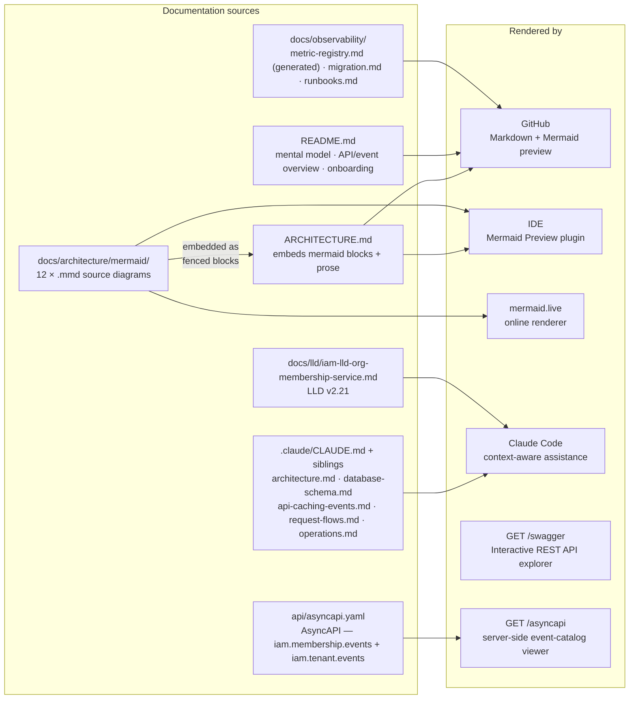

| Document | Description |
|----------|-------------|
| [`.claude/architecture.md`](.claude/architecture.md) | Clean Architecture directory tree, shared library integration, dep rules |
| [`.claude/database-schema.md`](.claude/database-schema.md) | 8 tables, enums, RLS/tenant/seat/migration/trigger invariants |
| [`.claude/api-caching-events.md`](.claude/api-caching-events.md) | Full endpoint catalogue (P-*/I-*/O-*), cache TTLs, event catalogue |
| [`.claude/request-flows.md`](.claude/request-flows.md) | Provisioning, delegate-impact resolution, invite→accept, concurrency, GDPR |
| [`.claude/operations.md`](.claude/operations.md) | Security, observability, configuration, CI/CD, dependency degradation matrix |
| [`docs/observability/README.md`](docs/observability/README.md) | How the observability standard is implemented here, the generated metric inventory (`metric-registry.md`), renamed/removed metric names (`migration.md`) and per-alert runbooks (`runbooks.md`) |
| [`docs/architecture/README.md`](docs/architecture/README.md) | Standalone Mermaid diagram set index (the 12 `.mmd` files embedded above) |
| [`docs/lld/iam-lld-org-membership-service.md`](docs/lld/iam-lld-org-membership-service.md) | Full LLD (v2.20) — §16 open-question register, §17 error taxonomy, §19 migration strategy |

Render a diagram locally: open any `.mmd` file in a Mermaid-aware IDE (VS Code + Mermaid Preview, IntelliJ + Mermaid plugin) or paste into [mermaid.live](https://mermaid.live).
